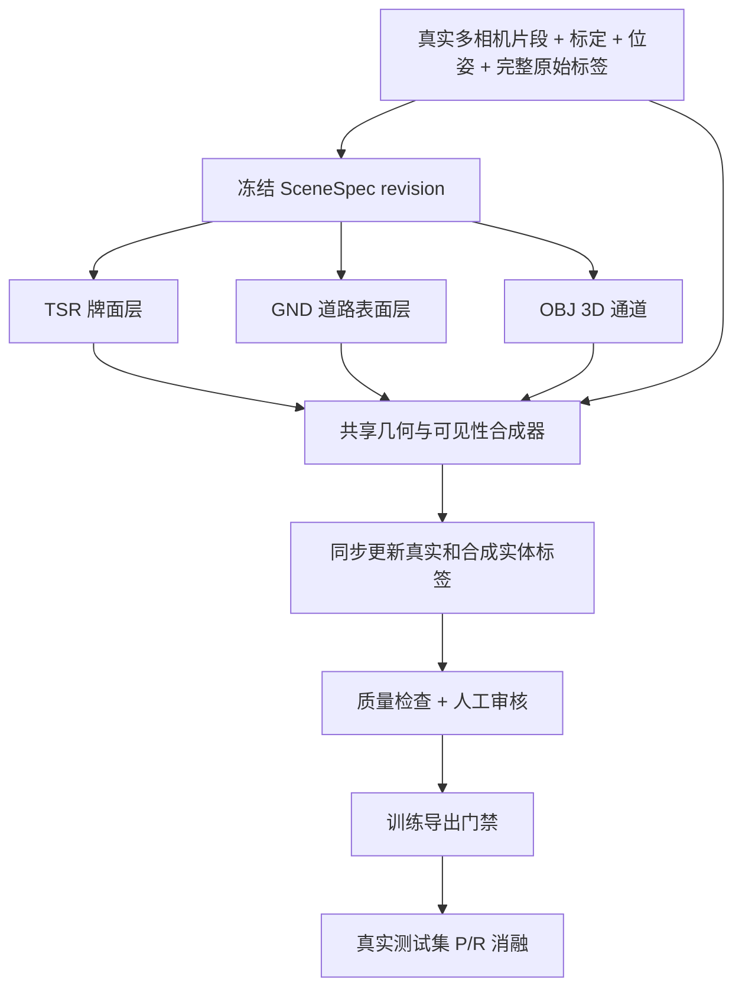

# TSR / OBJ / GND 现版评估与可实施改造方案

版本：2026-11-21，服务器 10.2.248.34:8010。初始源码快照 07:55；纳入点选放置增量的快照截至 **08:07（北京时间）**。

目标：以实拍数据为底图，构造几何、遮挡、语义、时间一致的三模块联合样本，交付给同一个 BEV 网络，并在独立真实测试集上验证 Precision / Recall。

本次只读了服务器源码、既有产物、日志及少量 GET 接口；没有修改、部署、重启服务，没有提交渲染任务。下文“现状”对应上述快照；“补丁”仅在本地；“目标”是下一轮实施验收要求。

## 1. 结论与实施顺序

**当前版本已经比上一轮更容易操作，也修复了部分错误的成功判定；但还不适合直接批量生产 BEV 训练数据。最影响效果的是相机/坐标错位、真实前景遮挡缺失、原始标签不完整，而不是缺少更多按钮或单纯缺少 UE。**

按以下顺序推进：

1. 合入本包针对当前快照的局部修复，消除串帧、标注错配、点选坐标缩放和 GND 纹理方向错误。
2. 用有真实标定和原始标签的少量片段，打通固定相机、可放置区域、深度/实例通道、三模块联合合成与标注。
3. 用统一场景工作台替换不断叠加的页面补丁，统一任务状态和预览版本。
4. 完成真实集上的分任务、分类别 P/R 消融，再扩产。

UE 继续作为 OBJ 的局部 3D 渲染器。TSR 的已存在牌面替换可以继续使用二维/平面透视；GND 的平坦道路先使用米制 2.5D 投影。坡道、起伏道路、明显复杂遮挡再接真实道路网格，不必先重建整座城市。

## 2. 交接包是什么、不是哪种完成状态

| 内容 | 位置 | 当前状态 |
|---|---|---|
| 现版完整候选文件 | `candidate/` | 基于读取的源码生成，未部署 |
| 统一 diff | `current_version_fixes.patch` | 可审查；先核对版本再应用 |
| 可重复构建器 | `build_candidates.py` | 离线运行，严格核对输入快照哈希 |
| 远端版本核对 | `verify_remote_baseline.py` | 只读 SSH，不写服务器 |
| 几何/合成核心 | `code/bev_core.py` | 本地单测通过；依赖真实输入 |
| UE 5.3 相机接入候选 | `code/ue_camera.py` | CPU 投影数学通过测试；未进行 UE 渲染验证 |
| 前端场景状态与请求控制 | `code/workbench_state.mjs` | 本地单测通过，待接入新工作台 |
| 参数与进程参数构造 | `code/dispatch_contract.py` | 候选 server.py 已引用 |
| 持久任务仓库 | `code/job_store.py` | 本地测试通过，待接入 API/worker |
| P/R 配对比较 | `code/pr_compare.py` | 比较既有评测器的 TP/FP/FN，不能替代任务匹配器 |
| 本次证据 | `evidence/` | 现网已有图片/标注/日志、只读接口返回 |
| 现场源码快照 | `snapshot/` | 记录具体版本，不能当作服务器最新备份长期覆盖 |
| 测试 | `tests/` | Python 16 项、Node 9 项通过 |

没有完成的部分必须明确：**UE 的标定投影与 ID/depth/alpha 输出适配、真实深度和完整原始标签接入、新工作台完整页面、生产 worker 生命周期、端到端 UE 渲染回归、真实训练实验**。本包不是宣称全部完成的新版平台，也不包含凭空生成的标定/深度。后文给出这些工作的输入输出、修改位置、步骤和验收方法。

## 3. 本次现版证据

### 3.1 已经变好的部分

- OBJ 已从 TSR 检测质量模块拆出 `obj_quality.py`。最新任务 `obj_20261121_075015` 成功产出 2 帧 / 11 框；日志明确为 `REVIEW_REQUIRED`，通过 0、待复核 2、失败 0；耗时约 3.5 分钟。此前的模块导入阻断在这个任务里没有复现。
- OBJ 输出保留 `occlusion: null`、`training_eligible: false`，避免把不可靠的遮挡估计当真值。
- GND 新增 `gnd_project.py`，确实走实拍底图 + 2.5D 投影，不必通过 UE 才能出线。现有输出写明未验证、不可训练。
- 页面已有模块入口、任务汇总、原图/结果视图，并新增原图点选放置。这是合理方向，应保留操作意图，重整状态和坐标实现。
- OBJ 资产模块已加入部件拼装和材质处理。不能再沿用上一轮“没有接任何模型”的判断；但实际最新锥桶样本仍有明显材质与位置问题。

### 3.2 实际产物中的问题

本次核对的是指定样本，不将两张图推断为全部数据的统计质量。

**OBJ，任务 `obj_20261121_075015` 第一帧：** 锥桶覆盖在真实车辆车顶/车窗区域；缺少正确的地面接触关系；材质呈浅白代理外观。对应标注仍明确缺真实标定、实例深度通道和多相机时序。


**GND，任务 `gnd_20261121_073344`：** 线条覆盖在左侧车辆、前车、路缘和车头区域；没有使用“可见路面 + 真实前景遮挡”限制。虚线外观也不符合沿道路纵向分段的预期。


这些图片只能作为问题证据，不能作为合格训练样本。原图左上角色块等采集叠加内容也要在数据接入阶段识别，保持处理与标签一致，防止形成数据集捷径。

### 3.3 问题、依据和具体处理

| 优先级 | 当前问题与证据 | 后果 | 处理 |
|---|---|---|---|
| P0 质量 | `demo_obj_v4.py` 普通模式随机移动/旋转相机；点选模式又把相机移到目标后 2m；底图本身不动 | 对不齐目标位置、透视、大小 | 固定到对应真实帧相机，物体在场景坐标里变；见第 6 节 |
| P0 质量 | `pixel2world.py` / GND manual H / OBJ FOV 不是同一标定模型 | 点击位置不等于最终落点，三个模块坐标不统一 | 同一 SceneSpec、K、T、图像域；见第 5 节 |
| P0 质量 | OBJ 仍从 EXR 亮度阈值提 mask，`all_fg` 不是实例 ID | 暗材质漏 mask，同类遮挡错误 | 导出实例 ID + alpha + 深度，见第 6 节 |
| P0 质量 | GND 没有路面掩码、真实前景掩码、深度可见性 | 标线穿车、穿路缘/车头 | 合成前限制可见区域，见第 7 节 |
| P0 质量 | `gnd_project.py` 纹理列方向对应了整个纵向长度，行方向对应窄线宽 | 虚线/磨损方向错误 | 本包调整四角对应关系；还需按米制长度重采样 |
| P0 质量 | `make_gnd_tex.py` wear 越大阈值越低，掉漆反而越少 | UI 参数与结果相反 | 本包修复单调性；现存纹理需另行重建 |
| P0 数据 | 无完整原始 GT 接入、真实多相机/时序记录 | 真实目标变成未标注负样本，联合训练被污染 | 导出门禁，第 9 节 |
| P0 前端 | OBJ/GND 共用一个 `ST`；异步响应没有版本校验 | 切换任务/模块后图像与标注串用 | 本包按模块分状态、请求取消与版本校验 |
| P0 前端 | `pick()` 只换图片，未更新当前帧标注 | 画框、底图、后续点选上下文错误 | 每帧同步请求对应标注 |
| P0 前端 | GND stem 先剥 `_composed` 再剥 `_gnd_composed` | 请求变成 `cand_04_gnd` 而非 `cand_04` | 使用一个后缀表达式 |
| P0 后端 | annotation 找不到指定 stem 时返回第一帧 | 静默错配，用户不易发现 | 本包改 404；现网只读 GET 已证实此行为 |
| P0 点选 | canvas 用 CSS 尺寸绘制却又除 DPR；原图接口可能缩到 1600，但校准为 1920 | 点击像素坐标缩放错误 | 用实际 CSS rect + 标注原始 width/height |
| P0 点选 | 提交读取 `mpObjBg`，不一定是当前展示底图 | GND/OBJ 生成到另一张背景 | 从当前帧标注 source_image 取值 |
| P0 点选 | 新点选脚本的 `show()` 属于另一 IIFE，作用域不可见 | 生成后结果加载报错 | 调已导出的 `window.__showModuleWorkbench` |
| P0 后端 | OBJ dispatch/place 把输入拼入 `su -c` shell；秒级时间命名任务 | 参数边界不可靠、并发同秒目录冲突 | 本包改 argv + 参数校验 + UUID |
| P1 状态 | manifest 仍四位帧号、轮换 layout，实际输出六位且可固定 layout | 追溯与重跑配置不一致 | 本包统一帧号、记录实际固定布局及 seed |
| P1 状态 | `obj_quality.aggregate` 未知状态可被当通过；重叠检查可能覆盖已有 failed | 错误降级 | 本包未知状态保留 unchecked、failed 不回退 |
| P1 TSR | `tsr_param_preview.py` 读取 overcover 却没传入 renderer；多数宣称参数未使用 | 用户拖动参数没有效果 | 只暴露已生效参数，统一预览/正式入口 |
| P1 TSR | `pick_material` 可退到大类乃至第一个素材 | 类别/限速数字可能不符 | 使用 asset_id + taxonomy 精确映射，不命中返回 422 |
| P1 平台 | 多套 dispatch/run/hybrid 入口，localStorage 注册状态；GND HTTP 请求中同步 subprocess，最长 180s | 刷新状态不可靠、长请求占工作线程、重复提交 | 异步 Job API + 持久仓库，第 10 节 |
| P1 交互 | 新点选 3 秒后仅查看一次结果，OBJ 实测任务数分钟；部分代码提交即 ended | 易把任务已提交/完成混淆 | 统一串行轮询/SSE，按后端状态显示 |
| P1 性能 | 初始 HTML 有 52 处 `setInterval`、0 处 `AbortController`；增量又添轮询；图像 URL 附时间戳 | 存在重复扫描、缓存失效与过期响应风险 | 移除旧补丁监听，单控制器、内容哈希缓存 |

“52 处”是源码出现次数，**不是声称 52 个网络请求同时运行**。服务使用 `ThreadingHTTPServer`，不能把 GND 同步请求描述成整个服务必然单线程阻塞。

GET 小样记录：OBJ 图片列表约 129ms，GND 图片列表约 37.5ms，错误 stem 返回首帧约 31.6ms；每项仅一次，只能说明当时可访问，不能推断 p95、吞吐或页面 FPS。浏览器连接失败，本次没有真实浏览器全流程/流畅度实测。

## 4. 三模块前端应如何配合

### 4.1 一个场景工作台，三个编辑工具

保留顶部 TSR / OBJ / GND，但语义改成“当前编辑哪个图层”，而不是三个独立项目/底图/任务容器。

```text
场景名 / 版本 / 帧 / 相机 / 标定状态 / 草稿保存状态
┌────────────────┬──────────────────────────┬────────────────────┐
│ 片段与帧列表    │ 原图/合成图统一视口       │ 当前选择对象属性   │
│ 多相机缩略图    │ 缩放、平移、对比、遮挡层 │ TSR/OBJ/GND 编辑器 │
│                │ 小型 BEV 俯视图          │ 几何与质量提示     │
│ 图层树         │ 同一对象多相机联动       │ 参数作用说明       │
│ TSR / OBJ/GND   │                          │                    │
├────────────────┴──────────────────────────┴────────────────────┤
│ 时间轴 / 编辑预览 / 最终小样 / 提交批量 / 审核 / 导出            │
└────────────────────────────────────────────────────────────────┘
```

共享：scene_id、revision、frame_id、camera_id、原图与原始标注、标定、缩放/平移、图层列表、任务、质量报告。模块独立：当前工具、选中对象、参数折叠状态。

切换模块只切工具，不清底图、不换帧、不重新请求全部资源；查看其他任务属于“打开场景/结果”，必须有可见上下文变化，不能悄悄覆盖当前草稿。

### 4.2 具体交互规则

| 操作 | TSR | OBJ | GND |
|---|---|---|---|
| 新增/选择 | 选择已有牌面实例；新建 3D 标牌单列模式 | 可见路面点选底部中心，在 BEV 移动/旋转 | BEV 折线或道路控制点，设置线型、宽度、dash/gap |
| 坐标 | 牌面四角/平面；优先保留现有支杆 | 米制位置、朝向、尺寸 | 米制道路曲线/表面 |
| 拖动反馈 | 浏览器更新牌面轮廓 | 即时显示投影盒和接地点 | 即时投影中心线/边界 |
| 松手后 | 防抖生成快速预览 | 排队生成低分辨率渲染，不连续启动 UE | 快速 CPU 投影 |
| 禁止/提示 | 类别素材不匹配、牌面不可靠 | 点在车辆/人/天空/车头，校准缺失 | 路面外、过近地平线、不适用平面假设 |
| 跨模块影响 | 新物体可遮挡标牌，需要重算可见标签 | 遮挡标线/标牌和真实目标 | 可被真实和合成物体遮挡 |

必须区分三种按钮：

- **编辑预览**：低分辨率或几何轮廓，带“预览”标识，不可训练导出。
- **最终小样**：相同 SceneSpec、资产版本、seed，用正式通道/合成器产生完整结果与标签，供质检。
- **批量生成**：冻结 revision，统一作业；完成后进入审核，不自动等于训练合格。

前端预览结果绑定 `(scene_id, revision, frame_id, camera_id)`。在旧图上显示新参数、在新图上显示旧框都不允许；加载中保留旧图时必须注明旧版本，并暂时禁用在旧图上的点选提交。

### 4.3 推荐实现方式

第一步用本包修复现有 HTML；第二步将工作台功能提取到独立模块，而不是继续追加 IIFE 拦截原按钮。

```text
dashboard/workbench/
  app.mjs                # 一次挂载，统一事件注册与卸载
  scene-store.mjs        # 引用本包 makeStore
  viewport.mjs           # 图像域、缩放、投影、图层显示
  tools/tsr.mjs
  tools/obj.mjs
  tools/gnd.mjs
  jobs.mjs               # 一个轮询控制器或 SSE 连接
  quality.mjs            # 完成/审核/可训练分开显示
```

不强制引入 React/Vue；现阶段原生 ES module 即可。先稳定状态边界，再决定框架迁移。

实际请求接法：

```javascript
import {makeStore, previewKey, LatestRequest} from './workbench_state.mjs';
const store = makeStore(initialSceneDraft);
const pending = new LatestRequest();
async function refreshPreview() {
  const draft = store.get();
  const key = previewKey(draft);
  await pending.run(async signal => {
    const res = await fetch('/api/v2/previews', {
      method: 'POST', signal,
      headers: {'Content-Type':'application/json'},
      body: JSON.stringify({scene_id:draft.sceneId, revision:draft.revision,
                            frame_id:draft.frameId, camera_id:draft.cameraId})
    });
    if (!res.ok) throw new Error(`预览失败 ${res.status}`);
    return res.json();
  }, preview => store.applyPreview(key, preview));
}
```

这个示例中的 `/api/v2/previews` 是**新接口目标**，不是现网已有接口。OBJ 超过快速预算时应返回 202 + job_id；上述调用改为轮询该 job，完成后再 `applyPreview`，不能假装同步秒出最终渲染。

### 4.4 性能验收目标（待实测）

- 同机缓存命中后模块切换 p95 < 100ms；拖动几何反馈 p95 < 33ms。
- GET job/status p95 < 200ms；提交 job p95 < 300ms，不包含渲染执行时间。
- 同一视口最多一个有效预览请求；轮询上一请求完成后才安排下一次，隐藏页暂停。
- 原图、缩略图、标注按内容哈希/版本缓存，避免每次 `Date.now()` 强制下载。任务日志限长/分页，不每秒拉整文件。
- 30 分钟连续切模块/切帧后监听器与定时器数量稳定；用浏览器 Performance/Network 和服务请求日志验证，不能仅凭观感通过。

## 5. 统一场景、坐标和数据契约

### 5.1 最小场景合同

下面是字段结构示意；资产、标定、labelset 的引用必须由服务端解析，不能把示例 ID 当作真实数据。

```json
{
  "schema_version": "bev-scene/1",
  "scene_id": "drive01_clip0042",
  "revision": 12,
  "seed": 20261121,
  "split_group": "drive01",
  "image_domain": "rectified",
  "coordinate_system": "ego_x_forward_y_left_z_up_m",
  "calibration_id": "rigA_calib_v3",
  "original_labelset_id": "drive01_labels_reviewed_v2",
  "frames": [{
    "frame_id": "000101", "timestamp_ns": 1795212345000000000,
    "ego_pose_ref": "poses/000101.json",
    "views": [{"camera_id":"front", "image_id":"image_front_000101",
               "width":1920, "height":1080}]
  }],
  "layers": {
    "TSR": [{"entity_id":"sign_42", "mode":"replace_face", "source_instance_id":"orig_sign_7",
             "asset_id":"br_speed60_v2", "class_id":"speed_limit_60"}],
    "OBJ": [{"entity_id":"cone_1", "asset_id":"cone_pbr_v3",
             "pose_world_ref":"objects/cone_1.json", "size_m":[0.4,0.4,0.7]}],
    "GND": [{"entity_id":"line_1", "class_id":"lane_dashed_white",
             "polyline_world_ref":"roads/line_1.json", "width_m":0.15,
             "dash_m":3.0, "gap_m":3.0, "phase_m":0.0}]
  }
}
```

生产合同还需包含相机 K、distortion_model/D、T_camera_ego、T_world_ego(t)、曝光/时间偏移、资产哈希、renderer/compositor/label policy 版本。可使用引用，避免重复写矩阵；导出时必须冻结引用内容。

**本包代码固定坐标：** ego：x 前、y 左、z 上，单位米；OpenCV camera：x 右、y 下、z 前；列向量 `P_camera = T_camera_ego @ P_ego`。UE 常用 x 前、y 右、z 上且单位厘米，位置换算为 `[100*x, -100*y, 100*z]`；姿态也要做基变换，不能只改 y 数值而复用旧 yaw。跨世界与车辆局部坐标时另乘对应位姿，不能混用。

现版 manual H 输入实际是两维地面坐标，代码又混用 Y/Z 与 X/Y、left/right 命名。应写一次有版本号的迁移器，将旧 H 标为 `legacy_manual_ground`、`preview_only`，不能当作真实 BEV 标定直接重命名后放行。

### 5.2 几何路径

1. 数据接入确定原始图像域。若用 rectified 图，图像与全部原始标签一起去畸变/重映射，保存新的 K。
2. 浏览器点选先根据图片实际 CSS rect 求归一化位置，再乘**标注记录的原始宽高**，不能直接用缩略图 naturalWidth。
3. `pixel_to_ground()` 用同一个 K、T 与路面平面求射线交点；过地平线、相机后方、无校准直接拒绝。
4. 在地面/道路网格上求可放置点，检查真实物体占据、路缘和车头掩码；点在车身上不能把该像素射线延伸到地面后就当可放置。
5. 物体在 world/ego 坐标保存；所有相机从同一实体投影。相机属于实拍帧，不随物体重新瞄准。

```python
from bev_core import pixel_to_ground, project, ground_homography
point_ego = pixel_to_ground([u_original, v_original], K, T_camera_ego)
uv_check, depth, valid = project([point_ego], K, T_camera_ego)
# 这里只验证数学往返；真实校准还需独立测量点，不能用同一四点自证正确。
H_ego_xy_to_pixel = ground_homography(K, T_camera_ego)
```

### 5.3 标定与时序验收

- 先选至少一个带完整 K/D/外参、同步时间、ego pose、原始 GT 的真实片段作为黄金样本。
- 用不参与拟合的地面/立体点检查重投影；建议起始门槛 p95 ≤ 2px，最终由距离、分辨率和模型需求定。人工猜测的 6m/20m/3.5m 不能证明真实米制位置。
- 静止标牌、路标、锥桶的 world pose 和 entity_id 跨帧不变；移动 OBJ 使用轨迹，不能逐帧重新随机抽样。
- asset/appearance seed 按 scene_id + entity_id 固定；时间变化来自轨迹、曝光等显式参数。帧号不是“重新随机一次场景”的理由。
- 多相机、连续帧作为整组放行/隔离；某一帧相机缺失不能静默补一张随机图。

## 6. OBJ：先修位置与遮挡，再提升资产质感

### 6.1 现版精确修改位置

`/data/avsynth/Content/Python/demo_obj_v4.py`：

- 删除普通模式随机相机 x/y/yaw 与点选模式 `tgt_x - 200` 相机重定位逻辑。用帧标定给相机位姿。
- 将 `layout_placed` 的输入改为显式 SceneSpec 实体数组；不再通过 `value or 800` 替换合法的零值。
- `--layout` 仅用于生成草稿；正式执行严格消费冻结后的对象列表与轨迹，不能执行时再随机挑对象。
- `CAM` 不再默认 FOV 70°、高度 1.35m 作为训练真值。参数缺失允许预览但拒绝训练交付。

`/data/avsynth/Content/Python/modules/obj.py`：

- 数据级 `entity_id` 与渲染级 instance ID 分开；一个汽车的车身/轮胎应共用实例 ID。
- ID 不能用 `stencil_of(cls)` 的类别值代替，两个锥桶必须可区分。
- `ASSET_HINTS` 或拼装失败回退基础几何体时，记录 `asset_quality=proxy` 与阻断项；正式训练模式禁止静默回退。

`/data/avsynth/HybridPipeline/scripts/obj_post.py`：

- 替换 brightness mask 与 `single_mask & all_fg` 逻辑。
- 所有合成和标签消费同一 revision 的 alpha、instance_id、z_synth、z_real、mask。
- 写入真实的可见 mask、可见框、完整框、截断、遮挡证据；无法计算的字段为 null 并阻断对应交付，不写假 0。

### 6.2 渲染适配器必须交付的通道

| 通道 | 约定 | 验收方法 |
|---|---|---|
| foreground RGB | 线性空间、预乘 alpha、与底图同像素域 | 黑/白背景合成没有黑边或白边；保留色彩处理版本 |
| alpha | 几何覆盖率，不是亮度阈值 | 黑色轮胎也应有完整 alpha |
| visible_instance_id | 整数唯一实例，最近表面 ID | 两个同类锥桶遮挡时 ID 不混淆 |
| depth_camera_z_m | 相机 z 深度，米，背景无效另存 validity | 已知 5/10/20m 标定板；不能把 ray distance 当 z |
| per_instance_full_mask | 同一相机中不被其他对象遮挡的 in-frame mask | 与 visible mask 比较得到 in-frame occlusion |
| shadow_transmittance | 无阴影=1；接收面适用区域另存 mask | 无物体时输出 1，不改变真实底图 |
| entity_table | 实例 ID -> entity_id、类别、资产哈希、pose、size | 所有非零 ID 均能查到实体 |

服务器 UE 版本从 `Engine/Build/Build.version` 读取为 **5.3.2**。不要拿新版本编辑器 API 写完就假设可运行。

UE 5.3 的 `SceneCaptureComponent2D` 暴露自定义投影矩阵属性，可以作为精确内参适配入口；但其文档也提示自定义矩阵不自动改变裁剪判定，所以还必须检查画面边缘目标是否被错误剔除。[Epic UE 5.3 API](https://dev.epicgames.com/documentation/en-us/unreal-engine/python-api/class/SceneCaptureComponent2D?application_version=5.3)

可保留现有 EXR 管线逐步接通通道；若采用 Movie Render Queue 的 Object IDs/Depth 输出，要验证当前 5.3 项目、插件和抗锯齿模式实际支持情况，不把调色后的 ID 图当整数真值。[Epic 渲染通道说明](https://dev.epicgames.com/documentation/en-us/unreal-engine/cinematic-render-passes-in-unreal-engine)

**UE 工程师的首个验收件不是一批美图，而是一个固定相机、两个互相遮挡的锥桶 + 一块已知距离板的通道包。** 在它通过数值验收以前，不开始大规模资产或批量优化。

本包还提供 `code/ue_camera.py`：`prepare_camera(K,T,W,H)` 在普通 Python worker 中计算 UE 坐标、相机旋转矩阵和非中心主点投影矩阵，输出 JSON；`apply_camera(actor,capture,contract)` 在 UE 中替换现有随机/瞄准相机逻辑。CPU 测试验证非中心主点、skew 的投影与 OpenCV 数学一致；**尚未验证 UE 5.3.2 实际 GPU 输出、半像素约定、裁剪及各通道一致性**，因此属于接入候选，必须经过上述黄金场景再启用。矩阵构造使用 UE 5.3 官方的 Plane/Matrix 接口。[Epic Matrix API](https://dev.epicgames.com/documentation/en-us/unreal-engine/python-api/class/Matrix?application_version=5.3)

```python
# 普通 Python worker：K/T 必须来自真实帧标定。
from ue_camera import prepare_camera
contract = prepare_camera(K, T_camera_ego, width=1920, height=1080)
# 将 contract 写入该 job 的冻结配置，供 UE 读取。

# UE 脚本中：替换 demo_obj_v4.py 的相机随机移动/瞄准区段。
from ue_camera import apply_camera
apply_camera(cam, comp, contract)
# cam/comp 为现有 SceneCapture actor/component；capture 相对 actor 不应有额外变换。
# 目标纹理须与 contract 的 W/H 一致，RGB/depth/alpha/ID 共用此相机。
```

### 6.3 接入已提供的合成函数

```python
import cv2
import numpy as np
from bev_core import composite_obj, instance_visibility

bg_rgb = cv2.cvtColor(cv2.imread(bg_path), cv2.COLOR_BGR2RGB) / 255.0
# 以下均由同一 frame/camera/revision 的通道适配器读取，禁止随机补值。
rgb, visible_ids, uncertain = composite_obj(
    bg_rgb=bg_rgb,
    fg_linear_premult=passes['fg_linear_premult'],
    alpha=passes['alpha'],
    instance_id=passes['instance_id'],
    z_synth=passes['depth_camera_z_m'],
    z_real=real['depth_camera_z_m'],
    real_depth_valid=real['depth_valid'],
    protected=real['protected_mask'],
    shadow_transmittance=passes['shadow_transmittance'],
    shadow_receiver=real['shadow_receiver_mask'])
if uncertain.any():
    blockers.append('unresolved_real_occlusion')
stats = {iid: instance_visibility(full_masks[iid], visible_ids, iid)
         for iid in entity_table}
cv2.imwrite(output_png, cv2.cvtColor(np.rint(rgb*255).astype(np.uint8), cv2.COLOR_RGB2BGR))
```

必须补充的集成检查：RGB/深度/ID 尺寸一致、色彩域一致、帧相机 revision 一致；已知深度必须有置信度/来源。单目深度可用于预览排序，不能未经米制标定就作为 BEV 米制真值。保守前景 mask 只能保底防穿帮，不能替代完整三维遮挡。

### 6.4 资产与逼真度

先做锥桶、轿车、卡车三类，每类选少量高质量资产作为固定黄金资产，逐项确认：真实尺寸、底部 pivot、朝向、各零件归属、PBR 材质、纹理细节、阴影接触、表面粗糙度和多级细节。

素材带许可、来源、版本与哈希；标牌反光/车辆玻璃等材质要单独验证。不能仅把几何体涂色后称为真实素材。

背景已经包含噪声/压缩/曝光。优先对合成对象匹配当地的曝光、色温、模糊和噪声；不要全图反复 JPEG 编码或全局加锐化。线性合成后统一编码一次，保存无损训练母版；若训练合同需要 JPEG，再从母版编码并对实际交付图复查。

## 7. GND：米制几何、路面约束、拓扑一起做

### 7.1 立即能修的部分

本包已修复当前纹理四角对应顺序和 wear 单调性。这两项不需要重新设计架构，但**不解决穿车、错误相机或拓扑缺失**。

现有纹理按固定长度生成，当前代码又拉伸到任意 length，这会改变 dash/gap 的真实长度。正式方案按米制分段：先生成 3m 实线 + 3m 间隔等几何段，再投影每一段；磨损纹理跟随世界坐标，不随帧像素随机跳动。

```python
from bev_core import metric_line_quads, raster_ground, composite_ground
quads = metric_line_quads(x0=6, x1=30, y=1.75, width=.15,
                          dash_m=3, gap_m=3, phase_m=0)
coverage, polygons = raster_ground(quads, K, T_camera_ego, (height, width))
out_rgb, visible_paint_alpha = composite_ground(
    bg_rgb, paint_rgb, coverage,
    road_visible=visible_road_mask,
    protected=real_foreground_and_hood_mask,
    wear_keep=world_anchored_wear_keep)
```

这个函数是直线/平面路径的实际代码；弯道要沿米制中心线采样并用切向/法向构造条带网格，坡道用道路网格逐点投影。停止线是横向条带、斑马线是一组横向条带，不应复用纵向长条代码硬拉伸。

### 7.2 交付标签必须区分

- `geometry_full`：世界坐标中的完整道路标线曲线/多边形，含 class、width、dash/gap/phase。
- `mask_visible_camera`：实际可见、经过真实和合成物体遮挡的图像 mask。
- `mask_paint_appearance`：磨损后的实际漆面覆盖率。
- `bev_semantic` 与 `bev_visibility`：完整 BEV 语义和可见性分开。不要因为相机中被车挡住就自动删掉 BEV 道路语义。
- `topology`：lane_id、左右边界、前后继/分叉、停止线/横道关联、道路方向。新增线如果没有相应语义含义，不应生成“只有像素没拓扑”的训练标签。

磨损后的 lane 检测任务是否监督连续中心线、可见漆面或完整拓扑，由现有模型 loss/GT 合同确定；不能用一个二值 mask 包办三类任务。

### 7.3 对当前底图的具体处理

`cand_04.jpg` 既有真实车辆又有既有道路标线。新增标线前应决定：

1. **新增相容标线**：不得产生不合理交叉/重复；更新对应 road graph。
2. **替换已有标线**：必须有原始线实例与可靠去除方式；重建被去除区域的背景并审核，不能留一条真实线再叠一套不一致标签。
3. **无可靠路面/标定/背景恢复**：该样本停留为预览或丢弃，不进入正式训练包。

验收至少包括：车辆/行人/车头/路缘保护区内新增漆面为 0；近远处线宽投影合理；不同相机的虚线相位相同；跨帧没有滑动；完整路网与可见 mask 的定义一致。

## 8. TSR：保留有效路径，消除语义与预览不一致

现版 `pipeline_v411.py` 仍继承 V4.6，增加双牌门禁。不要为了统一模块而强制把已有牌面替换全部迁到 UE。

修改顺序：

1. **统一预览与正式入口**：`render_selected.py`、`batch_walk.py`、`tsr_param_preview.py` 调同一个 renderer adapter，使用同一素材 ID、同一 seed、同一参数解释；结果记录 `effective_params`。
2. **只显示有效参数**：当前 overcover 没传给 renderer，其余部分参数只在界面/说明中存在。短期隐藏/禁用这些参数并说明；中期明确加入 renderer 构造或 render 参数并写 A/B 数值回归，不能只改 UI。
3. **严格素材映射**：素材清单 `asset_id -> country,class_id,value,shape,texture_sha256`。选择限速 60 只能匹配相应素材；找不到返回 422，不随便退到第一张 PNG。
4. **保留真实载体**：优先只换牌面，保留真实支杆、安装位置、旧牌的物理尺度/可见遮挡；不能随意覆盖整块矩形区域。
5. **透视与遮挡**：可靠四角/牌面平面优先；圆牌仅凭椭圆角度不应自动赋 3D 姿态。无法可靠拟合时进入人工修正或跳过。
6. **固定时序语义**：同一实体在同一序列中限速数字、类别、资产不随机变化。可生成多个 scene variant，但同一 variant 内稳定。

严格素材解析核心可直接按下面方式替换当前模糊选择策略：

```python
def resolve_sign_asset(catalog, asset_id, country, class_id):
    item = catalog.get(asset_id)
    if item is None:
        raise ValueError('asset_not_found')
    if item['country'] != country or item['class_id'] != class_id:
        raise ValueError('asset_taxonomy_mismatch')
    return item['path'], item['sha256']
```

TSR 验收分别报：检测 P/R、识别 P/R、数字/类别混淆矩阵、距离/像素大小/遮挡分桶。不要只用生成时同一个检测器的置信度证明质量；最终仍由真实测试集评价。

## 9. 三模块联合合成与标签闭环

### 9.1 一次生成整组数据



图层树的顺序不代表物理遮挡。地面漆先作用到道路表面；真实车辆遮挡漆面；合成对象再按深度参与遮挡；对象可能挡住标牌。用共享深度/实例缓冲求最终可见性，不能让用户把 GND 图层拖到 OBJ 上面就改变物理关系。

每个适配器输出“修改层 + 几何/标签”，不能只输出一张压平 JPG 再让下个模块当成新的真实底图。否则既无法正确复算遮挡，也会累积压缩损伤。

### 9.2 原始标签的处理

- 原始完整标签是正式训练的必要输入；检测器提案不是完整 GT。
- TSR 替换更新原 sign entity 的语义和牌面，不保留同一位置两份相互矛盾标注。
- OBJ 新增实体，同时更新被遮挡真实实体的可见 mask/框和遮挡属性；原始 3D box 是否保留由任务合同决定，通常不能因遮挡就删除物理实体。
- GND 修改道路语义、线实例和拓扑；未改动道路与原有真实目标继续保留。
- 多任务训练允许有任务 mask，但必须由训练 loader/loss 显式支持。不能默认“未标注”就是背景，也不能默认缺失一个任务标签不影响共享 BEV 网络。

### 9.3 导出目录与字段

```text
dataset_release_v001/
  manifest.json                 # 数据/工具/资产/校准/标注版本与哈希
  split_groups.json             # scene/drive 级划分与派生关系
  scenes/<scene_id>/scene.json
  scenes/<scene_id>/calibration.json
  scenes/<scene_id>/poses.jsonl
  scenes/<scene_id>/frames/<frame_id>/
    cameras/<camera_id>/image.png
    cameras/<camera_id>/instances.png
    cameras/<camera_id>/visible_labels.json
    annotations_3d.json
    gnd_vectors.json
    bev_semantic.npy
    bev_visibility.npy
    quality.json
  lineage.jsonl                 # 每个 variant -> 真实源片段
```

instances 的位宽由实例总量决定，不能固定类 ID 的 8-bit stencil 作为全局实体编号。保存深度时单列单位和定义；不可见、未知、无标签要有明确编码。

导出时重新计算 eligibility，不相信浏览器发来的 true。至少检查本包 `export_decision` 的 9 项，并验证 evidence_sha256 确实对应存在且版本匹配的检查产物；函数本身只是门禁规则，不验证证据文件真实性。

服务执行成功、质量通过、可训练必须分三维显示。现有 `unchecked` 资产不得经前端改名为“通过”后导出。

## 10. 后端任务、稳定性与接口落地

### 10.1 当前入口到目标入口

| 现版入口 | 过渡处理 | 目标 |
|---|---|---|
| `/api/obj/dispatch` | 本包校验参数、无 shell argv、唯一 job ID | 适配成冻结 SceneSpec 的 OBJ job |
| `/api/obj/place` | 本包修请求边界；几何仍需替换 | 点选只编辑场景，不直接拼环境变量启动 UE |
| `/api/gnd/dispatch`、`/api/gnd/project` | 本包参数/唯一 ID；仍同步，需异步化 | 统一 GND adapter |
| TSR walk/selected/preview | 保留旧任务读取 | 同一 TSR renderer adapter |
| `/api/hybrid/submit` 等 | 不再新增一套 UI 状态 | 统一 job 查询与生命周期 |
| `/api/job/annotation` | 本包严格按 stem，缺失 404 | 显式 frame_id + camera_id + artifact_id |

新接口（待实施）：

```text
GET  /api/v2/capabilities
GET  /api/v2/scenes/:id?revision=12
PUT  /api/v2/scenes/:id        If-Match: revision-12
POST /api/v2/previews          scene_id/revision/frame_id/camera_id
POST /api/v2/jobs              Idempotency-Key: <client-request-id>
GET  /api/v2/jobs/:job_id
POST /api/v2/jobs/:job_id/cancel
GET  /api/v2/jobs/:job_id/artifacts?cursor=...
POST /api/v2/releases          经 server-side gate 后导出
```

`capabilities` 返回每模块 `supports_preview / supports_final / supported_params / supported_assets / calibration_requirement`。当前不支持的滑块自动禁用；不要猜参数是否被后端使用。

任务请求建议：

```json
{"scene_id":"drive01_clip0042","revision":12,"mode":"final",
 "modules":["TSR","OBJ","GND"],"frame_ids":["000101","000102"]}
```

请求只是引用。服务端读取冻结场景，补上版本/哈希，写入 job.spec；不能让浏览器直接传服务器任意脚本路径、输出路径或命令。

### 10.2 接入本包 JobStore

先放到独立的状态库，例如 `/data/avsynth/state/workbench_v2.db`，不要直接改现有 jobs.db schema。API 处理器和 worker 共用仓库，但每次操作各自建立 SQLite 连接。

API 提交核心：

```python
from job_store import JobStore, public_job
store = JobStore('/data/avsynth/state/workbench_v2.db')

# 以下是接到现有 Handler 后的处理器主体；owner 必须来自服务端认证上下文。
def submit_frozen_job(owner, idempotency_key, frozen_spec):
    row, created = store.submit(owner, idempotency_key, frozen_spec)
    return (202 if created else 200), public_job(row)
```

接入步骤：

1. 在 `do_POST` 的旧分支之前增加 `/api/v2/jobs` 路由，验证 scene/revision 存在且归属合法；服务端解析冻结 spec 后调用上面函数。未知 revision 返回 404/409，body 过大或非法返回 400/413。
2. `GET /api/v2/jobs/:id` 调 `store.get(id, owner)` 和 `public_job`；不要返回 lease token。
3. worker 调 `claim()` 获取一条 QUEUED；抢不到立即退出/退避，不重复启动 UE。
4. 当前机器保留单个 GPU `flock`；GPU 任务和 CPU GND/后处理分队列。JobStore 只负责状态，不替代 GPU 锁。
5. worker 每 10s heartbeat，lease 初始 60s。等待 UE 时也要心跳：用 `Popen.poll()` 循环或专用心跳线程，不阻塞调用整个 `subprocess.run` 而无人续约。
6. 取消 queued 直接 CANCELLED；取消 running 先 `cancel_requested=true`。worker 停止其**自己记录的进程组**，等待回收，确认停止后才写 CANCELLED。不能只改前端文字，也不能 `pkill Unreal` 误杀别的任务。
7. worker 退出时核对 requested/produced/failed/review 数量；产物必须原子提交，未完成目录不列入可下载结果。
8. 服务重启扫描 expired lease，只报告为“运行状态待核实”；先查 pid/start_time/GPU lock，确认旧进程已退出再创建 retry job。不能自动抢过期 lease 后再启动第二个 UE。

本包 JobStore 已实现幂等、单事务领取、lease token、防旧 worker 完成、取消请求与终态确认；没有实现启动 UE、进程组终止、SSE、工件原子提交。这些由 runner 适配器完成，并按下述验收测试。

### 10.3 Job 状态与 Quality 状态分开

Job：`QUEUED -> RUNNING -> SUCCEEDED | REVIEW_REQUIRED | FAILED | CANCELLED`。

Quality：`passed | failed | unchecked`；`training_eligible` 再由数据合同计算。即使某个结构检查 passed，也不代表完整样本可训练。

失败结果包含 stage、error_code、retryable、具体 frame/camera；错误日志限长。异常分为输入/标定/资产错误（不重试）和进程异常/临时 I/O（有限重试）。重试 job 保留 parent_job_id，与原始 scene revision、seed 不变。

幂等 key 相同但 spec 不同返回 409，防止网络超时后重复提交或错误复用。当前 UUID 补丁只解决目录冲突，**不等价于业务幂等**。

### 10.4 稳定性验收

- 连点提交/网络重试，同一 idempotency key 只产生一个任务。
- 关闭浏览器后任务继续，重新打开能恢复后端状态，不依赖 localStorage。
- 重启 API 不丢已排队任务；重启 worker 不重复执行仍运行的 UE。
- 失败、超时、缺帧、后处理失败均能闭合计数；不能“有一张图就成功”。
- 取消 running 确认子进程退出；过期 worker 不可覆盖新状态。
- 只读查看任务不加载大模型、不启动 GPU、不修改任务；列表有分页。

## 11. 如何把数据真正用于提升 P/R

### 11.1 固定基线

使用同一 BEV 网络版本、训练步数/预算、真实训练数据、预处理、损失权重、checkpoint 选择规则。先保存 baseline 在独立真实验证集和测试集的逐场景匹配结果。

测试集按 drive/scene 分组隔离；同一源图的不同合成 variant、相邻帧、同一多相机时间组不能跨 train/val/test。合成不能使用测试场景做背景。

阈值和匹配规则在真实验证集固定；测试集只做最终报告，不能反复调阈值到 P/R 好看。

### 11.2 实验矩阵

| 实验 | 数据 | 目的 |
|---|---|---|
| A0 | 原真实数据 | 基线 |
| A1 | 真实 + TSR | 查看标牌收益及其他任务回退 |
| A2 | 真实 + OBJ | 查看对象难例收益及其他任务回退 |
| A3 | 真实 + GND | 查看道路/线任务收益及其他任务回退 |
| A4 | 真实 + 同场景一致的三模块联合样本 | 验证共享 BEV 的联合效果 |
| A5 | A4 仅改变合成比例 | 选择混合比例 |

合成占比可先试 5% / 10% / 20%，这是实验档位，不是保证最优比例。优先覆盖真实错误分析找到的长尾，不平均生成大量模型已经会的简单样本。三个任务共用网络，任何单任务提升都要同时看另外两个任务的退化。

### 11.3 P/R 报告定义

- TSR：检测和识别分开；数字/类别错误不能只算框匹配成功。
- OBJ：沿用模型现有 2D/3D/BEV 匹配规则，固定 IoU/中心距离阈值，按类别、距离、像素大小、遮挡报告。
- GND：沿用现有线实例/分割/拓扑匹配器，固定距离容差、连接关系规则。像素分割 P/R 与线实例 P/R 不混为一个值。
- 全部报告每类 P、R、TP/FP/FN、PR 曲线、支持样本数，保留常见类和长尾类分桶。
- 对重要类增加“固定 P 下 R”和“固定 R 下 P”，避免仅通过改置信度阈值制造提升。
- 建议使用至少 3 个训练 seed 做重复；统计置信区间按 scene bootstrap，不把相邻视频帧当独立样本。

`code/pr_compare.py` 接收已有评测器的逐场景 TP/FP/FN，输出配对 scene bootstrap 的 ΔP/ΔR 与 95% 区间；它不会替换模型的匹配规则。

```bash
python code/pr_compare.py metrics_obj_cone_fixed_threshold.json --out pr_obj_cone_comparison.json
```

放行建议：目标长尾桶有稳定收益，同时关键常见类无不可接受回退。具体 ΔP/ΔR 和置信区间容忍线由现有业务指标确定；本次没有得到真实基线，所以不能承诺“提升 5%”等数值。

## 12. 可直接分配的实施清单

下表是首轮排期估计，不是现网已完成的工作；人天取决于数据/资产是否齐备。

| 顺序 | 负责人 | 修改对象 | 交付验收件 | 预计 |
|---|---|---|---|---|
| 1 | 前后端 | 本包 candidate 的 7 个文件 | 25 项本地回归 + 测试环境页面检查 | 1–2 人天 |
| 2 | 数据/算法 | 标定、pose、完整 GT、可见路面/前景数据接入 | 1 个多相机真实黄金片段及数据 manifest | 2–4 人天，缺数据则先补 |
| 3 | 渲染 | demo_obj_v4、obj.py、capture pass | 固定相机双锥桶深度/实例/alpha 标准件 | 3–5 人天 |
| 4 | 图像/算法 | obj_post、GND/TSR adapter、共享合成器 | 30–50 个审核通过的小样，含三模块联合样本 | 3–5 人天 |
| 5 | 前端 | 统一 store、viewport、tool、job controller | 切模块不丢场景、帧/相机同步、不会串帧 | 3–5 人天 |
| 6 | 后端 | v2 jobs/runner、工件/导出状态 | 重复提交/取消/重启/缺帧演练 | 3–5 人天 |
| 7 | 算法训练 | 数据 loader、任务 mask、真实集评测 | A0–A4 对比 + 分类/分桶 P/R | 取决于训练耗时 |

2–6 可在输入合同冻结后部分并行，但第 3 项通道验收未通过不能将第 4 项标为“可训练”；第 7 项未通过不能以图像好看作为项目成功。

首个质量样板建议固定：阴天有真实前车的场景，加入 1 个锥桶、替换 1 个牌面、增加 1 条相容标线。要求三种修改都在同一个 frame/camera/revision 下，锥桶不浮空，线不穿车，原始标签保留且可见性更新。完成这个样板再扩批，避免一次改十种材质却无法判断收益来源。

## 13. 本地验证、合入和回滚

### 13.1 本地复现

在解压目录执行：

```bash
python build_candidates.py
python -m unittest discover -s tests -p test_core.py -v
node --test tests/test_state.mjs tests/test_candidate_front.mjs
python verify_remote_baseline.py
```

本次使用 Python 3.14.7、NumPy 2.5.2、OpenCV 5.0.0、Node 24.19.0；算法代码未用 OpenEXR 解码，本次未装依赖。生产依赖应使用项目已有锁定环境，在测试机核对兼容性，不要直接升级生产 Python/OpenCV。

25 项测试的范围：几何投影/射线往返；UE 投影矩阵 CPU 数学一致性；米制虚线；保护区不覆盖；深度遮挡与未知区域；实例独立可见性；导出门禁；参数边界；质量状态；wear 单调性；GND 纹理方向；manifest；后端精确标注；持久任务；P/R 比较；状态 store；旧响应；串行轮询；真实候选 HTML 的脚本解析、跨模块/跨帧异步顺序、DPR/原图坐标。

Node 的 DOM fixture 验证实际候选脚本逻辑，但不是浏览器真实布局/点击/帧率测试。UE 通道、真实生产合成和训练 P/R 未在本次运行。

### 13.2 候选文件映射

```text
candidate/opt/ue5_synth/dashboard/index.html
candidate/opt/ue5_synth/dashboard/server.py
candidate/opt/ue5_synth/dashboard/dispatch_contract.py     # 新增
candidate/opt/ue5_synth/tools/gnd_project.py
candidate/opt/ue5_synth/tools/make_gnd_tex.py
candidate/data/avsynth/HybridPipeline/scripts/obj_quality.py
candidate/data/avsynth/HybridPipeline/scripts/obj_batch_worker.py
```

`code/` 其他文件是第二阶段接入组件，不会因复制 candidate 就自动启用。候选里没有伪造新的 UE 相机标定；因此仅合入 P0 文件后，OBJ/GND 成图仍不能直接放行训练。

### 13.3 合入操作

1. 先运行 `verify_remote_baseline.py`。返回非零说明有人继续改了服务器：对照 snapshot/current diff 做三方合并，**不要整文件覆盖**。服务器在本次评估中确实有并行改动。
2. 在测试 checkout 导入 candidate，新 helper 与 server 同目录。审查 `current_version_fixes.patch`，避免把另一位开发者的新功能覆盖掉。
3. 用隔离端口、隔离输出目录、隔离 DB 启动测试服务。注意现有 server 含后台自动后处理线程：先在测试配置禁用这些自动动作，不能把测试实例指到生产数据目录后直接启动。
4. 人工检查：TSR/OBJ/GND 切换、快速换帧、慢网络乱序、DPR 1/1.5/2、1600 预览对 1920 标注、空模块任务筛选、标注 404、当前底图点选。
5. OBJ `runuser` argv 需在测试机用 `algo` 运行环境验证一次。新进程仍须使用统一 GPU 锁和可写输出路径；本包没有在生产启动它。
6. GND 新纹理先写到新版本目录，审核后切引用；修改 make_gnd_tex 源码不会自动更新已有 PNG。新旧产物记录纹理版本，不覆盖旧交付数据。
7. 通过测试和质量样板后，由实际实施人员安排部署窗口。先保存部署前**当前**文件、环境和配置；逐步启用，回滚恢复该备份与版本引用。不要拿 07:55 快照作为未来部署时的回滚版本。

本包有意不提供一条自动 SSH 覆盖/重启生产的命令。这里需要的是针对现版的可审查实施和验收，而不是绕过正在进行的开发直接覆盖服务器。

## 14. 实施完成的判定

平台完成：同一场景下三模块可连续编辑、预览、批量、复核、恢复任务；不会串帧、失去草稿、假完成。

数据完成：真实标定、完整原始 GT、合成实例与道路拓扑、遮挡/可见性、多相机/时序、版本追溯和分组切分均满足模型输入合同。

效果完成：在冻结的真实测试集、同一训练预算和匹配规则下，目标 P/R 有可复现收益，关键任务没有不可接受的回退。

这三个条件分别验收。增加渲染按钮、结构检查通过或图像观感改善，都不能替代最后两项。


## 附录 A：完整接入代码

以下内容与 code/ 文件一致；修改代码后重新运行 package_report.py 更新文档。

### bev_core.py

```python
"""Geometry/compositing primitives. RGB inputs; metres; no UE/network side effects.

Ego axes: x forward, y left, z up. OpenCV camera: x right, y down, z forward.
T_camera_ego maps column homogeneous points FROM ego TO camera.
This module does not estimate calibration, depth, masks, or certify training data.
"""
import hashlib
import json
import math
import cv2
import numpy as np


def _finite(value, shape=None):
    a = np.asarray(value, dtype=np.float64)
    if shape is not None and a.shape != shape:
        raise ValueError(f"expected {shape}, got {a.shape}")
    if not np.isfinite(a).all():
        raise ValueError("non-finite array")
    return a


def stable_seed(scene_id, entity_id, master_seed):
    """Static entity seed: deliberately independent of frame/chunk/camera."""
    raw = json.dumps([scene_id, entity_id, master_seed], separators=(",", ":"))
    return int.from_bytes(hashlib.sha256(raw.encode()).digest()[:8], "big")


def project(points_ego, K, T_camera_ego, near_m=0.1):
    p = _finite(points_ego)
    if p.ndim != 2 or p.shape[1] != 3:
        raise ValueError("points must be N x 3")
    K = _finite(K, (3, 3))
    T = _finite(T_camera_ego, (4, 4))
    if not np.allclose(T[3], [0, 0, 0, 1]):
        raise ValueError("invalid homogeneous transform")
    R = T[:3, :3]
    if not np.allclose(R.T @ R, np.eye(3), atol=1e-5) or not np.isclose(np.linalg.det(R), 1, atol=1e-5):
        raise ValueError("extrinsic rotation must be proper orthonormal")
    camera = p @ R.T + T[:3, 3]
    q = camera @ K.T
    valid = camera[:, 2] > near_m
    uv = np.full((len(p), 2), np.nan)
    uv[valid] = q[valid, :2] / q[valid, 2:3]
    return uv, camera[:, 2], valid


def ground_homography(K, T_camera_ego):
    """Only for a rectified pinhole image and plane ego.z == 0."""
    K = _finite(K, (3, 3))
    T = _finite(T_camera_ego, (4, 4))
    project([[1, 0, 0]], K, T)  # validate transform convention/rotation
    H = K @ T[:3, [0, 1, 3]]
    if abs(np.linalg.det(H)) < 1e-10:
        raise ValueError("degenerate road projection")
    return H


def pixel_to_ground(uv, K, T_camera_ego):
    """Intersect a rectified camera ray with ego z=0. No guessed camera height."""
    uv = _finite(uv, (2,))
    K = _finite(K, (3, 3))
    T = _finite(T_camera_ego, (4, 4))
    project([[1, 0, 0]], K, T)
    ray_camera = np.linalg.solve(K, [uv[0], uv[1], 1.])
    R, t = T[:3, :3], T[:3, 3]
    origin = -R.T @ t
    direction = R.T @ ray_camera
    if abs(direction[2]) < 1e-9:
        raise ValueError('ray parallel to ground')
    distance = -origin[2] / direction[2]
    if distance <= 0:
        raise ValueError('ground is behind camera')
    return origin + distance * direction


def metric_line_quads(x0, x1, y, width, dash_m=None, gap_m=None, phase_m=0):
    """Straight road only. Metric dash phase remains fixed in scene coordinates.

    Corner order: near-left, near-right, far-right, far-left; texture rows
    correspond to longitudinal distance, columns to lateral distance.
    Stop lines/crosswalks/curves require their own geometry, not this function.
    """
    vals = [x0, x1, y, width, phase_m]
    if not all(math.isfinite(v) for v in vals) or x1 <= x0 or width <= 0:
        raise ValueError("invalid metric line")
    if dash_m is None:
        spans = [(x0, x1)]
    else:
        if gap_m is None or not all(math.isfinite(v) and v > 0 for v in [dash_m, gap_m]):
            raise ValueError("positive dash and gap required")
        period = dash_m + gap_m
        first = math.floor((x0 - phase_m) / period)
        last = math.ceil((x1 - phase_m) / period)
        if last - first > 10000:
            raise ValueError("too many dash segments")
        spans = [(max(x0, phase_m + k * period), min(x1, phase_m + k * period + dash_m))
                 for k in range(first, last + 1)]
    return [np.array([[a, y + width/2, 0], [a, y - width/2, 0],
                      [b, y - width/2, 0], [b, y + width/2, 0]], dtype=float)
            for a, b in spans if b > a]


def raster_ground(quads, K, T_camera_ego, shape, supersample=2):
    """Reject near-plane crossings; caller must shorten/clip them explicitly."""
    h, w = shape
    if h <= 0 or w <= 0 or supersample not in [1, 2, 4]:
        raise ValueError("invalid raster size")
    mask = np.zeros((h * supersample, w * supersample), np.uint8)
    polygons = []
    for quad in quads:
        uv, _, valid = project(quad, K, T_camera_ego)
        if not valid.all():
            raise ValueError("line crosses near plane")
        if np.max(np.abs(uv)) > 1e6:
            raise ValueError("unstable projection")
        polygons.append(uv.tolist())
        cv2.fillConvexPoly(mask, np.rint(uv * supersample).astype(np.int32), 255)
    coverage = cv2.resize(mask.astype(np.float32) / 255, (w, h), interpolation=cv2.INTER_AREA)
    return coverage, polygons


def to_linear(rgb):
    s = _finite(rgb)
    if np.any((s < 0) | (s > 1)):
        raise ValueError("RGB must be normalized to [0,1]")
    return np.where(s <= .04045, s / 12.92, ((s + .055) / 1.055) ** 2.4)


def to_srgb(linear):
    x = np.clip(linear, 0, 1)
    return np.where(x <= .0031308, 12.92 * x, 1.055 * x ** (1/2.4) - .055)


def _mask(value, shape):
    a = _finite(value, shape)
    if np.any((a < 0) | (a > 1)):
        raise ValueError("mask outside [0,1]")
    return a


def composite_ground(bg_rgb, paint_rgb, coverage, road_visible, protected, wear_keep):
    """Masks are mandatory: visible road; real cars/hood/pavement protected.

    wear_keep comes from scene-anchored texture, NOT independent screen noise.
    Returns RGB and visible paint alpha, not complete road topology/GT.
    """
    bg = to_linear(bg_rgb)
    h, w, c = bg.shape
    if c != 3:
        raise ValueError("RGB image required")
    shape = (h, w)
    alpha = (_mask(coverage, shape) * _mask(road_visible, shape)
             * (1 - _mask(protected, shape)) * _mask(wear_keep, shape))
    paint = to_linear(paint_rgb)
    if paint.shape not in [(3,), bg.shape]:
        raise ValueError("paint must be RGB or H x W x RGB")
    return to_srgb(bg * (1-alpha[..., None]) + paint * alpha[..., None]), alpha


def composite_obj(bg_rgb, fg_linear_premult, alpha, instance_id, z_synth,
                  z_real, real_depth_valid, protected, shadow_transmittance,
                  shadow_receiver, depth_margin_m=0.05):
    """Composite UE layer against real geometry in CAMERA-Z metres.

    Invalid real depth is unresolved, not infinite. Return an uncertainty map;
    any unresolved foreground pixel blocks certified export. protected is a
    conservative real-foreground/hood mask. ID is a nearest-sampled integer
    instance buffer (not a class stencil). RGB and alpha must be aligned.
    Shadow visibility must have been computed for the same scene revision.
    """
    bg = to_linear(bg_rgb)
    shape = bg.shape[:2]
    fg = _finite(fg_linear_premult, bg.shape)
    a = _mask(alpha, shape)
    ids = np.asarray(instance_id)
    if ids.shape != shape or ids.dtype.kind not in 'ui' or (ids < 0).any():
        raise ValueError("integer nonnegative instance IDs required")
    zs = np.asarray(z_synth, dtype=float)
    zr = np.asarray(z_real, dtype=float)
    valid = np.asarray(real_depth_valid, dtype=bool)
    if any(x.shape != shape for x in [zs, zr, valid]):
        raise ValueError("depth dimensions mismatch")
    fg_present = a > 1e-5
    if np.any(fg_present & ((ids == 0) | ~np.isfinite(zs) | (zs <= 0))):
        raise ValueError("foreground missing instance ID or depth")
    valid = valid & np.isfinite(zr) & (zr > 0)
    blocked = _mask(protected, shape) > .5
    uncertain = fg_present & ~valid & ~blocked
    visible = valid & (zs + depth_margin_m < zr) & ~blocked
    av = a * visible
    # Shadow transmittance: 1 = unchanged, 0 = fully dark; no alpha squaring.
    tr = _mask(shadow_transmittance, shape)
    receiver = _mask(shadow_receiver, shape) * (~blocked)
    bg_shadowed = bg * (1 - receiver * (1-tr))[..., None]
    out = bg_shadowed * (1-av[..., None]) + fg * visible[..., None]
    visible_ids = np.where(av > .5, ids, 0).astype(ids.dtype)
    return to_srgb(out), visible_ids, uncertain


def visible_bbox(mask):
    ys, xs = np.where(np.asarray(mask, dtype=bool))
    if len(xs) == 0:
        return None
    return [int(xs.min()), int(ys.min()), int(xs.max()) + 1, int(ys.max()) + 1]


def instance_visibility(full_mask, visible_ids, iid):
    full = np.asarray(full_mask, dtype=bool)
    visible = np.asarray(visible_ids) == iid
    if full.shape != visible.shape or iid <= 0 or np.any(visible & ~full):
        raise ValueError("inconsistent instance masks")
    total = int(full.sum())
    return {"bbox_visible_xyxy": visible_bbox(visible), "visible_pixels": int(visible.sum()),
            "occlusion_in_frame": None if total == 0 else 1 - int(visible.sum()) / total}


REQUIRED_CHECKS = ('calibration', 'original_labels', 'geometry', 'occlusion',
                   'appearance', 'multi_camera', 'temporal', 'topology', 'split')


def export_decision(checks, required=REQUIRED_CHECKS):
    """Server creates checks with evidence references; never trust browser flags.

    required is a versioned dataset policy, not a user-selectable bypass.
    Evidence references must additionally be resolved/hash-verified by exporter.
    """
    blockers = []
    for name in required:
        c = checks.get(name, {})
        if c.get('status') != 'passed' or not c.get('evidence_sha256'):
            blockers.append(name)
    return {'training_eligible': not blockers, 'training_blockers': blockers}

```

### dispatch_contract.py

```python
"""Strict helpers for existing server.py routes. No process started on import."""
import math
import json
from pathlib import Path
import re
import uuid

LAYOUTS = {'cone_line', 'truck_block', 'ped_cross', 'dense'}
LINE_CLASSES = {'lane_solid_white', 'lane_dashed_white', 'lane_solid_yellow',
                'lane_double_yellow', 'stop_line', 'crosswalk_zebra', 'road_edge_white'}

def component(value):
    if not isinstance(value, str) or not re.fullmatch(r'[A-Za-z0-9_-][A-Za-z0-9_.-]{0,159}', value) or '..' in value:
        raise ValueError('invalid identifier')
    return value

def background(name, root='/data/render_hybrid/bgs'):
    component(name)
    base = Path(root).resolve()
    p = (base / name).resolve(strict=True)
    if p.parent != base or p.suffix.lower() not in ['.png', '.jpg', '.jpeg'] or not p.is_file():
        raise ValueError('background outside registered directory')
    return str(p)

def normalize_obj(body, root='/data/render_hybrid/bgs'):
    layout = body.get('layout', 'cone_line')
    if layout not in LAYOUTS:
        raise ValueError('unsupported layout')
    frames = body.get('frames', 4)
    if type(frames) is not int or not 1 <= frames <= 200:
        raise ValueError('frames must be an integer in [1,200]')
    bg = body.get('bg', 'cand_03.jpg')
    background(bg, root)
    return layout, bg, frames

def normalize_lines(lines):
    if not isinstance(lines, str) or len(lines) > 20000:
        raise ValueError('invalid line payload')
    if not lines:
        return ''
    parts = lines.split(';')
    if len(parts) > 128:
        raise ValueError('too many lines')
    normalized = []
    for part in parts:
        v = part.split(',')
        if len(v) != 4 or v[0] not in LINE_CLASSES:
            raise ValueError('line requires class,y,x,length')
        y, x, length = map(float, v[1:])
        if not all(math.isfinite(z) for z in [y, x, length]) or not (-30 <= y <= 30 and .1 <= x < 200 and .1 <= length <= 200):
            raise ValueError('invalid metric line extent')
        normalized.append(','.join([v[0], str(y), str(x), str(length)]))
    return ';'.join(normalized)

def job_id(module):
    if module not in ['obj', 'gnd']:
        raise ValueError('unknown module')
    return module + '_' + uuid.uuid4().hex

def normalize_picks(picks, module):
    classes = {'cone', 'car', 'suv', 'truck', 'pedestrian'} if module == 'OBJ' else LINE_CLASSES
    if not isinstance(picks, list) or not 1 <= len(picks) <= (20 if module == 'OBJ' else 10):
        raise ValueError('invalid placement count')
    result = []
    for point in picks:
        if not isinstance(point, dict) or point.get('cls') not in classes:
            raise ValueError('unknown placement class')
        u, v = float(point.get('u')), float(point.get('v'))
        if not all(math.isfinite(z) and 0 <= z < 32768 for z in [u, v]):
            raise ValueError('invalid original-image pixel coordinates')
        result.append({'u':u, 'v':v, 'cls':point['cls']})
    return result

def obj_argv(layout, bg, frames, out_dir, seed, placed=None):
    """Called AFTER normalize_obj. No shell, no interpolation into su -c."""
    env = ['DEMO_BG_NAME=' + bg]
    if placed is not None:
        env.append('DEMO_PLACED=' + json.dumps(placed, allow_nan=False))
    return ['runuser', '-u', 'algo', '--', 'env', *env,
            '/usr/bin/python3', '/data/avsynth/HybridPipeline/scripts/obj_batch_worker.py',
            'run', '--frames', str(frames), '--out', out_dir, '--chunk', str(min(frames, 4)),
            '--seed', str(seed), '--layout', layout, '--bg', '/data/render_hybrid/bgs/' + bg]

```

### job_store.py

```python
"""Durable single-host job repository, Python stdlib only.

No implicit stale-job retry: an expired lease may still own a live UE process.
An operator/supervisor must prove it is dead before submitting a retry.
Use one existing GPU flock in the runner. This repository is not a GPU lock.
"""
import contextlib
import hashlib
import json
import sqlite3
import time
import uuid

TERMINAL = {'SUCCEEDED', 'REVIEW_REQUIRED', 'FAILED', 'CANCELLED'}

class JobStore:
    def __init__(self, path):
        self.path = str(path)
        with self.connect() as db:
            db.executescript('''
                PRAGMA journal_mode=WAL;
                CREATE TABLE IF NOT EXISTS workbench_jobs(
                    id TEXT PRIMARY KEY, owner TEXT NOT NULL, idem TEXT NOT NULL,
                    digest TEXT NOT NULL, spec TEXT NOT NULL,
                    state TEXT NOT NULL, queue TEXT NOT NULL DEFAULT 'gpu', version INTEGER NOT NULL DEFAULT 1,
                    lease_token TEXT, lease_until REAL, cancel_requested INTEGER NOT NULL DEFAULT 0,
                    result TEXT, created REAL NOT NULL, updated REAL NOT NULL,
                    UNIQUE(owner, idem));
                CREATE INDEX IF NOT EXISTS wb_state ON workbench_jobs(state, created);
            ''')

    @contextlib.contextmanager
    def connect(self):
        db = sqlite3.connect(self.path, timeout=5, isolation_level=None)
        db.row_factory = sqlite3.Row
        db.execute('PRAGMA busy_timeout=5000')
        try:
            yield db
        finally:
            db.close()

    def submit(self, owner, idem, spec):
        if not owner or not idem or len(idem) > 200:
            raise ValueError('owner and bounded idempotency key required')
        encoded = json.dumps(spec, sort_keys=True, separators=(',', ':'), allow_nan=False)
        digest = hashlib.sha256(encoded.encode()).hexdigest()
        queue = spec.get('queue', 'gpu')
        if queue not in ['cpu', 'gpu']:
            raise ValueError('unknown resource queue')
        now = time.time()
        with self.connect() as db:
            db.execute('BEGIN IMMEDIATE')
            old = db.execute('SELECT * FROM workbench_jobs WHERE owner=? AND idem=?', (owner, idem)).fetchone()
            if old:
                db.rollback()
                if old['digest'] != digest:
                    raise ValueError('idempotency key reused with different content')
                return dict(old), False
            jid = uuid.uuid4().hex
            db.execute('INSERT INTO workbench_jobs(id,owner,idem,digest,spec,state,queue,created,updated) VALUES(?,?,?,?,?,?,?,?,?)',
                       (jid, owner, idem, digest, encoded, 'QUEUED', queue, now, now))
            db.commit()
        return self.get(jid, owner), True

    def get(self, jid, owner):
        with self.connect() as db:
            row = db.execute('SELECT * FROM workbench_jobs WHERE id=? AND owner=?', (jid, owner)).fetchone()
            if not row:
                raise KeyError(jid)
            return dict(row)

    def claim(self, ttl=60, queue='gpu'):
        now = time.time()
        with self.connect() as db:
            db.execute('BEGIN IMMEDIATE')
            row = db.execute("SELECT * FROM workbench_jobs WHERE state='QUEUED' AND queue=? ORDER BY created,id LIMIT 1", (queue,)).fetchone()
            if not row:
                db.rollback(); return None
            token = uuid.uuid4().hex
            db.execute("UPDATE workbench_jobs SET state='RUNNING',lease_token=?,lease_until=?,updated=?,version=version+1 WHERE id=?",
                       (token, now+ttl, now, row['id']))
            db.commit()
            return dict(db.execute('SELECT * FROM workbench_jobs WHERE id=?', (row['id'],)).fetchone())

    def heartbeat(self, jid, token, ttl=60):
        with self.connect() as db:
            changed = db.execute("UPDATE workbench_jobs SET lease_until=?,updated=? WHERE id=? AND lease_token=? AND state='RUNNING'",
                                 (time.time()+ttl, time.time(), jid, token)).rowcount
            if changed != 1:
                raise RuntimeError('lost lease')
            return bool(db.execute('SELECT cancel_requested FROM workbench_jobs WHERE id=?', (jid,)).fetchone()[0])

    def cancel(self, jid, owner):
        # RUNNING remains RUNNING until runner confirms process termination.
        with self.connect() as db:
            db.execute("UPDATE workbench_jobs SET cancel_requested=1, state=CASE WHEN state='QUEUED' THEN 'CANCELLED' ELSE state END,updated=?,version=version+1 WHERE id=? AND owner=? AND state IN ('QUEUED','RUNNING')",
                       (time.time(), jid, owner))
        return self.get(jid, owner)

    def finish(self, jid, token, state, result):
        if state not in TERMINAL:
            raise ValueError('invalid terminal state')
        with self.connect() as db:
            db.execute('BEGIN IMMEDIATE')
            row = db.execute("SELECT * FROM workbench_jobs WHERE id=? AND lease_token=? AND state='RUNNING'", (jid, token)).fetchone()
            if not row:
                db.rollback(); raise RuntimeError('lost lease or already finished')
            # A cancellation observed before final commit wins over success.
            if row['cancel_requested'] and state in {'SUCCEEDED', 'REVIEW_REQUIRED'}:
                db.rollback(); raise RuntimeError('runner must acknowledge cancellation')
            db.execute('UPDATE workbench_jobs SET state=?,result=?,lease_token=NULL,lease_until=NULL,updated=?,version=version+1 WHERE id=?',
                       (state, json.dumps(result, allow_nan=False), time.time(), jid))
            db.commit()

    def expired(self, now=None):
        with self.connect() as db:
            return [dict(r) for r in db.execute("SELECT * FROM workbench_jobs WHERE state='RUNNING' AND lease_until<?", (time.time() if now is None else now,))]

def public_job(row):
    """Do not return worker lease token, raw spec paths, or ownership internals."""
    return {k: row[k] for k in ['id','state','version','created','updated','cancel_requested']} | {
        'result': json.loads(row['result']) if row.get('result') else None}

```

### pr_compare.py

```python
"""Paired scene-bootstrap for already-matched TP/FP/FN at a FROZEN threshold.

Input JSON: {task, class, threshold_id, matcher_version,
 baseline:[{scene_id,tp,fp,fn}], candidate:[...]}.
The existing evaluator must supply matching: this file never substitutes a
generic box matcher for TSR recognition, OBJ 3D boxes, or GND topology.
"""
import argparse
import json
import numpy as np

def _rows(rows):
    result = {}
    for row in rows:
        sid = row['scene_id']
        if sid in result:
            raise ValueError('aggregate each scene exactly once')
        counts = [row[k] for k in ['tp','fp','fn']]
        if any(type(v) is not int or v < 0 for v in counts):
            raise ValueError('counts must be nonnegative integers')
        result[sid] = counts
    return result

def metrics(counts):
    tp, fp, fn = np.asarray(counts, dtype=float)
    return np.array([tp/(tp+fp) if tp+fp else np.nan,
                     tp/(tp+fn) if tp+fn else np.nan])

def compare(payload, repeats=2000, seed=11):
    for key in ['task','class','threshold_id','matcher_version']:
        if not payload.get(key): raise ValueError('missing '+key)
    a,b = _rows(payload['baseline']), _rows(payload['candidate'])
    if not a or set(a) != set(b):
        raise ValueError('identical nonempty real test scene set required')
    ids=sorted(a);A=np.array([a[k] for k in ids]);B=np.array([b[k] for k in ids])
    # Same GT positive count must be evaluated; unmatched synthetic GT is invalid.
    if np.any(A[:,0]+A[:,2] != B[:,0]+B[:,2]):
        raise ValueError('GT positives differ between runs')
    rng=np.random.default_rng(seed);deltas=[]
    for _ in range(repeats):
        selected=rng.integers(0,len(ids),len(ids))
        deltas.append(metrics(B[selected].sum(0))-metrics(A[selected].sum(0)))
    deltas=np.array(deltas);ma=metrics(A.sum(0));mb=metrics(B.sum(0))
    out={k:payload[k] for k in ['task','class','threshold_id','matcher_version']}
    out['scenes']=len(ids);out['bootstrap_repeats']=repeats;out['metrics']={}
    clean=lambda x: float(x) if np.isfinite(x) else None
    for i,name in enumerate(['precision','recall']):
        finite=deltas[np.isfinite(deltas[:,i]),i]
        ci=np.quantile(finite,[.025,.975]).tolist() if len(finite) else [None,None]
        out['metrics'][name]={'baseline':clean(ma[i]),'candidate':clean(mb[i]),
                              'delta':clean(mb[i]-ma[i]),'paired_scene_ci95':ci,
                              'valid_bootstrap_draws':len(finite)}
    return out

if __name__=='__main__':
    p=argparse.ArgumentParser();p.add_argument('input');p.add_argument('--out',required=True)
    a=p.parse_args()
    with open(a.input,encoding='utf-8') as f: result=compare(json.load(f))
    with open(a.out,'w',encoding='utf-8') as f:json.dump(result,f,ensure_ascii=False,indent=2,allow_nan=False)

```

### ue_camera.py

```python
"""UE 5.3 camera adapter candidate: CPU math tested, GPU capture NOT validated.

prepare_camera runs in the ordinary Python worker (NumPy). apply_camera runs
inside UE and consumes only JSON-compatible numbers (no NumPy dependency).
World origin is the current frame's ego origin; move every object consistently.
Input images must be rectified pinhole images, not raw fisheye frames.
"""
def prepare_camera(K, T_camera_ego, width, height, near_cm=10.0):
    import numpy as np
    from bev_core import project
    K=np.asarray(K,dtype=float);T=np.asarray(T_camera_ego,dtype=float)
    project([[1,0,0]],K,T)  # validates dimensions/finiteness/proper rotation
    if width <= 0 or height <= 0 or near_cm <= 0:
        raise ValueError('invalid capture dimensions/near plane')
    if not np.allclose(K[2],[0,0,1]) or abs(K[1,0])>1e-9 or K[0,0]<=0 or K[1,1]<=0:
        raise ValueError('invalid pinhole K')
    # UE local camera (forward,right,up) -> CV camera (right,down,forward).
    cv_from_ue=np.array([[0,1,0],[0,0,-1],[1,0,0.]])
    ue_from_ego=np.diag([1.,-1.,1.])
    location=100 * ue_from_ego @ (-T[:3,:3].T @ T[:3,3])
    actor_rotation=ue_from_ego @ T[:3,:3].T @ cv_from_ue
    actor_rows=np.eye(4);actor_rows[:3,:3]=actor_rotation.T  # UE row-vector matrix
    # View basis: right, up, forward. Reversed-Z infinite far projection.
    # Viewport mapping: u=(ndc.x+1)*W/2; v=(1-ndc.y)*H/2.
    fx,fy,cx,cy,skew=K[0,0],K[1,1],K[0,2],K[1,2],K[0,1]
    P=np.array([[2*fx/width,0,0,0],[-2*skew/width,2*fy/height,0,0],
                [2*cx/width-1,1-2*cy/height,0,1],[0,0,near_cm,0.]])
    return {'location_cm':location.tolist(),'actor_rotation_rows':actor_rows.tolist(),
            'projection_rows':P.tolist(),'width':width,'height':height,
            'near_cm':near_cm,'image_domain':'rectified',
            'validation_status':'cpu_math_only_requires_ue_reprojection_test'}


def apply_camera(actor, capture, contract):
    """UE-only; capture axes must coincide with actor axes, target size pre-set.

    Do not call this with an independently offset/rotated capture component.
    Use the same contract for RGB, depth, alpha, and IDs. Confirm culling and
    pixel-center conventions with the golden projection scene before release.
    """
    import unreal
    def matrix(rows):
        planes=[unreal.Plane(*map(float,row)) for row in rows]
        return unreal.Matrix(x_plane=planes[0],y_plane=planes[1],
                             z_plane=planes[2],w_plane=planes[3])
    actor.set_actor_location(unreal.Vector(*contract['location_cm']),False,False)
    actor.set_actor_rotation(matrix(contract['actor_rotation_rows']).get_rotator(),False)
    capture.set_editor_property('capture_every_frame',False)
    capture.set_editor_property('capture_on_movement',False)
    capture.set_editor_property('use_custom_projection_matrix',True)
    capture.set_editor_property('custom_projection_matrix',matrix(contract['projection_rows']))
    # Caller configures capture_source/target and captures each required pass.

```

### workbench_state.mjs

```javascript
// Shared scene draft + per-module UI state. No framework or network side effects.
export const MODULES = Object.freeze(['TSR', 'OBJ', 'GND']);
export function annotationStem(name) {
  return name.replace(/(?:_gnd)?_composed\.(?:jpg|jpeg|png)$/i, '');
}
export function makeStore(initial) {
  let state = structuredClone(initial);
  const listeners = new Set();
  const emit = () => listeners.forEach(fn => fn(structuredClone(state)));
  return {
    get: () => structuredClone(state),
    subscribe(fn) { listeners.add(fn); return () => listeners.delete(fn); },
    selectModule(module) {
      if (!MODULES.includes(module)) throw new Error('Unknown module');
      state.activeModule = module; emit(); // no scene revision bump or image reset
    },
    editLayer(module, layer) {
      if (!MODULES.includes(module)) throw new Error('Unknown module');
      state.layers[module] = structuredClone(layer);
      state.revision += 1;
      state.preview = null; state.quality = {status:'unchecked', training_eligible:false};
      emit();
    },
    selectFrame(frameId, cameraId) {
      state.frameId = frameId; state.cameraId = cameraId;
      state.preview = null; emit();
    },
    applyPreview(key, preview) {
      if (key !== previewKey(state)) return false;
      state.preview = structuredClone(preview); emit(); return true;
    }
  };
}
export function previewKey(s) {
  return JSON.stringify([s.sceneId, s.revision, s.frameId, s.cameraId]);
}
export class LatestRequest {
  constructor() { this.seq = 0; this.controller = null; }
  cancel() { this.seq++; this.controller?.abort(); this.controller = null; }
  async run(request, apply) {
    this.cancel();
    const seq = this.seq, controller = new AbortController();
    this.controller = controller;
    try {
      const result = await request(controller.signal);
      // AbortController alone is insufficient if server or cache ignores abort.
      if (seq !== this.seq || controller.signal.aborted) return false;
      await apply(result); return true;
    } catch (e) {
      if (seq !== this.seq || controller.signal.aborted) return false;
      throw e;
    } finally {
      if (seq === this.seq) this.controller = null;
    }
  }
}
export function startPoll(fetchJob, onJob, {intervalMs=1500, maxMs=15000, onError=()=>{}}={}) {
  const controller = new AbortController();
  let timer, stopped = false, delay = intervalMs;
  const terminal = new Set(['SUCCEEDED','REVIEW_REQUIRED','FAILED','CANCELLED']);
  async function tick() {
    if (stopped) return;
    try {
      const job = await fetchJob(controller.signal);
      if (stopped) return;
      onJob(job); delay = intervalMs;
      if (terminal.has(job.state)) return;
    } catch (e) {
      if (stopped) return;
      onError(e); delay = Math.min(maxMs, delay * 2);
    }
    if (!stopped) timer = setTimeout(tick, delay); // never overlap requests
  }
  tick();
  return () => { stopped = true; clearTimeout(timer); controller.abort(); };
}

```

## 附录 B：针对当前快照的完整补丁

先核对版本，再审查合并。

```diff
--- a/opt/ue5_synth/dashboard/index.html
+++ b/opt/ue5_synth/dashboard/index.html
@@ -9308,12 +9308,11 @@
           var m = String(t.module || MODS[k] || 'TSR').toUpperCase();
           if (m === window.__MODFILTER.toUpperCase()) saved[k] = t;
         });
-        if (Object.keys(saved).length || window.__MODFILTER === 'tsr') {
+        {
           var backup = window.__JOB_REG;
           window.__JOB_REG = saved;
-          var r = origRender.apply(this, arguments);
-          window.__JOB_REG = backup;
-          return r;
+          try { return origRender.apply(this, arguments); }
+          finally { window.__JOB_REG = backup; }
         }
       }
       return origRender.apply(this, arguments);
@@ -9609,10 +9608,20 @@
 (function(){
   'use strict';
 
-  var ST = { job: '', module: '', images: [], idx: 0, ann: null };
+  var STATES = Object.create(null);
 
   function $(id){ return document.getElementById(id); }
 
+  function invalidateSource(modName){
+    var orig = $('view-wb-' + modName + '_orig');
+    if (orig) {
+      orig.style.display = 'none';
+      orig.dataset.sourceImage = '';
+      orig.dataset.originalWidth = '';
+      orig.dataset.originalHeight = '';
+    }
+    if (window.__resetPick) window.__resetPick(modName);
+  }
   /* 建专属工作台视图 */
   function ensureView(modName){
     var id = 'view-wb-' + modName;
@@ -9769,9 +9778,11 @@
     var id = 'view-wb-' + modName;
     var color = modName === 'gnd' ? '#EAB308' : '#22C55E';
 
-    ST.job = job;
-    ST.module = module;
-    ST.idx = 0;
+    if (STATES[modName]) STATES[modName].controller.abort();
+    var ST = {job:job, module:module, images:[], idx:0, ann:null,
+              controller:new AbortController(), frameVersion:0};
+    STATES[modName] = ST;
+    invalidateSource(modName);
 
     $(id + '_job').textContent = job;
     $(id + '_count').textContent = '加载中…';
@@ -9781,8 +9792,10 @@
 
     try {
       var r = await fetch('/api/job/images?job=' + encodeURIComponent(job),
-                          {cache:'no-store'});
+                          {cache:'no-store', signal:ST.controller.signal});
+      if (!r.ok) throw new Error('HTTP ' + r.status);
       var d = await r.json();
+      if (STATES[modName] !== ST) return;
       var imgs = d.images || [];
       ST.images = imgs;
 
@@ -9811,18 +9824,24 @@
 
       pick(modName, 0);
 
-      // 加载标注（用于显示 bbox）
-      loadAnn(modName, job, imgs[0]);
+      // pick() loads image and matching annotation together.
 
     } catch(e) {
-      $(id + '_count').textContent = '加载失败: ' + e.message;
+      if (STATES[modName] === ST && e.name !== 'AbortError')
+        $(id + '_count').textContent = '加载失败: ' + e.message;
     }
   }
 
   function pick(modName, i){
+    var ST = STATES[modName];
+    if (!ST) return;
     var id = 'view-wb-' + modName;
     if (!ST.images[i]) return;
     ST.idx = i;
+    ST.frameVersion++;
+    ST.ann = null;
+    invalidateSource(modName);
+    loadAnn(modName, ST.job, ST.images[i], ST, ST.frameVersion);
     var color = modName === 'gnd' ? '#EAB308' : '#22C55E';
 
     Array.prototype.forEach.call($(id + '_list').querySelectorAll('.mrThumb'), function(el){
@@ -9838,14 +9857,15 @@
               '&name=' + encodeURIComponent(ST.images[i]) + '&t=' + Date.now();
   }
 
-  async function loadAnn(modName, job, imgName){
+  async function loadAnn(modName, job, imgName, ST, frameVersion){
     var id = 'view-wb-' + modName;
     try {
-      var stem = imgName.replace(/_composed\.jpg$/, '').replace(/_gnd_composed\.jpg$/, '');
+      var stem = imgName.replace(/(?:_gnd)?_composed\.(?:jpg|jpeg|png)$/i, '');
       var r = await fetch('/api/job/annotation?job=' + encodeURIComponent(job) +
-                          '&stem=' + encodeURIComponent(stem), {cache:'no-store'});
-      if (!r.ok) return;
+                          '&stem=' + encodeURIComponent(stem), {cache:'no-store', signal:ST.controller.signal});
+      if (!r.ok) throw new Error('annotation HTTP ' + r.status);
       var a = await r.json();
+      if (STATES[modName] !== ST || ST.frameVersion !== frameVersion) return;
       ST.ann = a;
 
       // 显示原图
@@ -9853,9 +9873,18 @@
         var orig = $(id + '_orig');
         orig.style.display = 'none';
         orig.onload = function(){ orig.style.display = 'block'; };
+        var sourceKey = ST.job + ':' + imgName;
+        if (orig.dataset.sourceKey !== sourceKey && window.__resetPick) window.__resetPick(modName);
+        orig.dataset.sourceKey = sourceKey;
+        orig.dataset.sourceImage = a.source_image || '';
+        orig.dataset.originalWidth = a.width || '';
+        orig.dataset.originalHeight = a.height || '';
         orig.src = '/api/tsr/src?path=' + encodeURIComponent(a.source_path) + '&max=1600';
       }
-    } catch(e) {}
+    } catch(e) {
+      if (STATES[modName] === ST && ST.frameVersion === frameVersion && e.name !== 'AbortError')
+        $(id + '_count').textContent = '标注加载失败: ' + e.message;
+    }
   }
 
   /* 事件委托兜底：即使 onclick 没绑上也能响应 */
@@ -9985,12 +10014,15 @@
     var cx = e.clientX - r.left;
     var cy = e.clientY - r.top;
     // 画布显示尺寸 = 图片显示尺寸，按 contain 缩放
-    var dispW = cv.width / (window.devicePixelRatio || 1);
-    var dispH = cv.height / (window.devicePixelRatio || 1);
+    var dispW = r.width;
+    var dispH = r.height;
     if (dispW <= 0 || dispH <= 0) return null;
 
-    var u = cx / dispW * img.naturalWidth;
-    var v = cy / dispH * img.naturalHeight;
+    if (cx < 0 || cy < 0 || cx >= dispW || cy >= dispH) return null;
+    var iw = Number(img.dataset.originalWidth), ih = Number(img.dataset.originalHeight);
+    if (!(iw > 0 && ih > 0)) return null;
+    var u = cx / dispW * iw;
+    var v = cy / dispH * ih;
     return [Math.round(u), Math.round(v)];
   }
 
@@ -10030,8 +10062,8 @@
     var ctx = cv.getContext('2d');
     ctx.clearRect(0, 0, cv.width, cv.height);
 
-    var sx = cv.width / Math.max(img.naturalWidth, 1);
-    var sy = cv.height / Math.max(img.naturalHeight, 1);
+    var sx = cv.width / Math.max(Number(img.dataset.originalWidth), 1);
+    var sy = cv.height / Math.max(Number(img.dataset.originalHeight), 1);
     var color = modName === 'gnd' ? '#EAB308' : '#22C55E';
 
     PICK[modName].forEach(function(p, i){
@@ -10062,9 +10094,12 @@
     if (btn) { btn.disabled = true; btn.textContent = '生成中…'; }
 
     // 取当前底图名
-    var bgSel = document.getElementById('mpObjBg');
-    var bg = 'cand_04.jpg';
-    if (bgSel) bg = bgSel.value;
+    var orig = $(id + '_orig');
+    var bg = orig && orig.dataset.sourceImage;
+    if (!bg) {
+      if (btn) { btn.disabled = false; btn.textContent = '按点选位置生成'; }
+      alert('请先加载该帧标注与原图'); return;
+    }
 
     try {
       var url = modName === 'gnd' ? '/api/gnd/dispatch' : '/api/obj/place';
@@ -10083,7 +10118,7 @@
       if (window.__JOB_REG) {
         window.__JOB_REG[d.job] = {
           id: d.job, type: 'render', module: modName.toUpperCase(),
-          started: Date.now(), ended: Date.now(), n: 0, country: '',
+          started: Date.now(), ended: 0, n: 0, country: '',
           path: (d.out || '') + '/' + bg
         };
         window.__JOB_MOD = window.__JOB_MOD || {};
@@ -10092,7 +10127,7 @@
       }
 
       // 轮询结果
-      setTimeout(function(){ show(d.job, modName.toUpperCase()); }, 3000);
+      setTimeout(function(){ window.__showModuleWorkbench(d.job, modName.toUpperCase()); }, 3000);
 
     } catch(e) {
       alert('请求失败：' + e.message);
@@ -10136,6 +10171,12 @@
     syncCanvas('gnd');
   });
 
+  window.__resetPick = function(modName){
+    PICK[modName] = [];
+    var count = $('view-wb-' + modName + '_placed');
+    if (count) count.textContent = '已放置 0 个';
+    drawMarks(modName);
+  };
   window.__pickState = PICK;
   window.__syncPickCanvas = syncCanvas;
   console.log('[PICK-PLACE] ready');
--- a/opt/ue5_synth/dashboard/server.py
+++ b/opt/ue5_synth/dashboard/server.py
@@ -1,3 +1,4 @@
+from dispatch_contract import component, background, normalize_obj, normalize_lines, normalize_picks, job_id, obj_argv
 # -*- coding: utf-8 -*-
 # server.py — UE5 合成流水线可视化操作台（零依赖单文件，服务器系统 python3 直接跑）
 # 干什么：网页上做 环境核查/生成任务/启动停止渲染/进度/后处理/日志查看，只暴露白名单动作。
@@ -1065,8 +1066,10 @@
         # [JOB-IMAGES] 列出某任务目录下的产出图
         if u.path == "/api/job/images":
             job = (q.get("job") or [""])[0]
-            if not job:
-                return self._send(400, {"error": "缺少 job"})
+            try:
+                component(job)
+            except ValueError as e:
+                return self._send(400, {"error": str(e)})
             cands = [
                 os.path.join(TSR_OUT_DIR, "walk_" + job),
                 os.path.join(TSR_OUT_DIR, job),
@@ -1092,8 +1095,11 @@
         if u.path == "/api/job/annotation":
             job = (q.get("job") or [""])[0]
             stem = (q.get("stem") or [""])[0]
-            if not job or "/" in job or ".." in job:
-                return self._send(400, {"error": "参数错误"})
+            try:
+                component(job)
+                component(stem)
+            except ValueError as e:
+                return self._send(400, {"error": str(e)})
             cands = [
                 os.path.join(TSR_OUT_DIR, "walk_" + job),
                 os.path.join(TSR_OUT_DIR, job),
@@ -1107,10 +1113,6 @@
             fp = ""
             if stem and os.path.isfile(os.path.join(ad, stem + ".json")):
                 fp = os.path.join(ad, stem + ".json")
-            elif os.path.isdir(ad):
-                js = sorted([f for f in os.listdir(ad) if f.endswith(".json")])
-                if js:
-                    fp = os.path.join(ad, js[0])
             if not fp:
                 return self._send(404, {"error": "标注不存在"})
             with open(fp, "r", encoding="utf-8") as f:
@@ -1120,8 +1122,11 @@
         if u.path == "/api/job/image":
             job = (q.get("job") or [""])[0]
             name = (q.get("name") or [""])[0]
-            if not job or not name or "/" in name or ".." in name:
-                return self._send(400, {"error": "参数错误"})
+            try:
+                component(job)
+                component(name)
+            except ValueError as e:
+                return self._send(400, {"error": str(e)})
             cands = [
                 os.path.join(TSR_OUT_DIR, "walk_" + job),
                 os.path.join(TSR_OUT_DIR, job),
@@ -2065,12 +2070,12 @@
                 body = self._body()
                 if not isinstance(body, dict):
                     body = {}
-                layout = str(body.get("layout") or "cone_line")
-                bg = str(body.get("bg") or "cand_03.jpg")
-                frames = int(body.get("frames") or 4)
-                frames = max(1, min(frames, 200))
-
-                job = "obj_" + time.strftime("%Y%m%d_%H%M%S")
+                try:
+                    layout, bg, frames = normalize_obj(body)
+                except (ValueError, TypeError, OSError) as e:
+                    return self._send(400, {"ok": False, "error": str(e)})
+
+                job = job_id("obj")
                 out_dir = "/data/render_hybrid/" + job
                 os.makedirs(out_dir, exist_ok=True)
                 os.chmod(out_dir, 0o777)
@@ -2088,14 +2093,8 @@
                         "created": time.strftime("%Y%m%d_%H%M%S"),
                     }, sf, ensure_ascii=False, indent=1)
 
-                cmd = ["su", "algo", "-c",
-                       "cd /data/avsynth/HybridPipeline/scripts && "
-                       "DEMO_BG_NAME=%s "
-                       "python3 obj_batch_worker.py run "
-                       "--frames %d --out %s --chunk %d --seed %d "
-                       "--layout %s --bg /data/render_hybrid/bgs/%s"
-                       % (bg, frames, out_dir, min(frames, 4),
-                          int(time.time()) % 100000, layout, bg)]
+                cmd = obj_argv(layout, bg, frames, out_dir,
+                               int(time.time()) % 100000)
 
                 lf = open(os.path.join(out_dir, "run.log"), "w")
                 subprocess.Popen(cmd, stdout=lf, stderr=subprocess.STDOUT,
@@ -2114,10 +2113,11 @@
                 if not isinstance(body, dict):
                     body = {}
                 bg = str(body.get("bg") or "cand_04.jpg")
-                picks = body.get("picks") or []
-                frames = int(body.get("frames") or 1)
-                if not picks:
-                    return self._send(400, {"ok": False, "error": "没有点选位置"})
+                try:
+                    _, bg, frames = normalize_obj({"bg": bg, "frames": body.get("frames", 1)})
+                    picks = normalize_picks(body.get("picks"), "OBJ")
+                except (ValueError, TypeError, OSError) as e:
+                    return self._send(400, {"ok": False, "error": str(e)})
 
                 # 像素 → UE 世界坐标
                 import sys as _sys
@@ -2144,7 +2144,7 @@
                     return self._send(400, {"ok": False,
                                             "error": "所有点都无法反投影到地面（可能在天空或太近）"})
 
-                job = "obj_" + time.strftime("%Y%m%d_%H%M%S")
+                job = job_id("obj")
                 out_dir = "/data/render_hybrid/" + job
                 os.makedirs(out_dir, exist_ok=True)
                 os.chmod(out_dir, 0o777)
@@ -2159,19 +2159,8 @@
                         "created": time.strftime("%Y%m%d_%H%M%S"),
                     }, sf, ensure_ascii=False, indent=1)
 
-                _placed_json = json.dumps(placed, ensure_ascii=False)
-                # shell 安全：转义单引号
-                _placed_json = _placed_json.replace("'", "'\\''")
-
-                cmd = ["su", "algo", "-c",
-                       "cd /data/avsynth/HybridPipeline/scripts && "
-                       "DEMO_BG_NAME=%s DEMO_PLACED='%s' "
-                       "DEMO_LAYOUT=placed "
-                       "python3 obj_batch_worker.py run "
-                       "--frames %d --out %s --chunk %d --seed %d "
-                       "--layout placed --bg /data/render_hybrid/bgs/%s"
-                       % (bg, _placed_json, frames, out_dir,
-                          min(frames, 4), int(time.time()) % 100000, bg)]
+                cmd = obj_argv("placed", bg, frames, out_dir,
+                               int(time.time()) % 100000, placed=placed)
 
                 lf = open(os.path.join(out_dir, "run.log"), "w")
                 subprocess.Popen(cmd, stdout=lf, stderr=subprocess.STDOUT,
@@ -2194,11 +2183,19 @@
                 if not isinstance(body, dict):
                     body = {}
                 bg = str(body.get("bg") or "cand_04.jpg")
-                lines = str(body.get("lines") or "")
+                try:
+                    background(bg)
+                    lines = normalize_lines(body.get("lines", ""))
+                except (ValueError, TypeError, OSError) as e:
+                    return self._send(400, {"ok": False, "error": str(e)})
                 picks = body.get("picks") or []
 
                 # 点选模式：像素 → 世界坐标 → 生成标线参数
                 if picks and not lines:
+                    try:
+                        picks = normalize_picks(picks, "GND")
+                    except (ValueError, TypeError) as e:
+                        return self._send(400, {"ok": False, "error": str(e)})
                     import sys as _sys
                     if TOOLS_DIR not in _sys.path:
                         _sys.path.insert(0, TOOLS_DIR)
@@ -2223,9 +2220,9 @@
                         return self._send(400, {
                             "ok": False,
                             "error": "所有点都无法反投影（可能点在天空或太近）"})
-                    lines = ";".join(parts)
-
-                job = "gnd_" + time.strftime("%Y%m%d_%H%M%S")
+                    lines = normalize_lines(";".join(parts))
+
+                job = job_id("gnd")
                 out_dir = "/data/render_hybrid/" + job
                 os.makedirs(out_dir, exist_ok=True)
 
@@ -2274,8 +2271,12 @@
                 if not isinstance(body, dict):
                     body = {}
                 bg = str(body.get("bg") or "cand_04.jpg")
-                lines = str(body.get("lines") or "")
-                tag = time.strftime("%Y%m%d_%H%M%S")
+                try:
+                    background(bg)
+                    lines = normalize_lines(body.get("lines", ""))
+                except (ValueError, TypeError, OSError) as e:
+                    return self._send(400, {"ok": False, "error": str(e)})
+                tag = job_id("gnd")
                 out_dir = "/data/render_hybrid/gnd_out_" + tag
                 os.makedirs(out_dir, exist_ok=True)
 
--- a/opt/ue5_synth/dashboard/dispatch_contract.py
+++ b/opt/ue5_synth/dashboard/dispatch_contract.py
@@ -0,0 +1,82 @@
+"""Strict helpers for existing server.py routes. No process started on import."""
+import math
+import json
+from pathlib import Path
+import re
+import uuid
+
+LAYOUTS = {'cone_line', 'truck_block', 'ped_cross', 'dense'}
+LINE_CLASSES = {'lane_solid_white', 'lane_dashed_white', 'lane_solid_yellow',
+                'lane_double_yellow', 'stop_line', 'crosswalk_zebra', 'road_edge_white'}
+
+def component(value):
+    if not isinstance(value, str) or not re.fullmatch(r'[A-Za-z0-9_-][A-Za-z0-9_.-]{0,159}', value) or '..' in value:
+        raise ValueError('invalid identifier')
+    return value
+
+def background(name, root='/data/render_hybrid/bgs'):
+    component(name)
+    base = Path(root).resolve()
+    p = (base / name).resolve(strict=True)
+    if p.parent != base or p.suffix.lower() not in ['.png', '.jpg', '.jpeg'] or not p.is_file():
+        raise ValueError('background outside registered directory')
+    return str(p)
+
+def normalize_obj(body, root='/data/render_hybrid/bgs'):
+    layout = body.get('layout', 'cone_line')
+    if layout not in LAYOUTS:
+        raise ValueError('unsupported layout')
+    frames = body.get('frames', 4)
+    if type(frames) is not int or not 1 <= frames <= 200:
+        raise ValueError('frames must be an integer in [1,200]')
+    bg = body.get('bg', 'cand_03.jpg')
+    background(bg, root)
+    return layout, bg, frames
+
+def normalize_lines(lines):
+    if not isinstance(lines, str) or len(lines) > 20000:
+        raise ValueError('invalid line payload')
+    if not lines:
+        return ''
+    parts = lines.split(';')
+    if len(parts) > 128:
+        raise ValueError('too many lines')
+    normalized = []
+    for part in parts:
+        v = part.split(',')
+        if len(v) != 4 or v[0] not in LINE_CLASSES:
+            raise ValueError('line requires class,y,x,length')
+        y, x, length = map(float, v[1:])
+        if not all(math.isfinite(z) for z in [y, x, length]) or not (-30 <= y <= 30 and .1 <= x < 200 and .1 <= length <= 200):
+            raise ValueError('invalid metric line extent')
+        normalized.append(','.join([v[0], str(y), str(x), str(length)]))
+    return ';'.join(normalized)
+
+def job_id(module):
+    if module not in ['obj', 'gnd']:
+        raise ValueError('unknown module')
+    return module + '_' + uuid.uuid4().hex
+
+def normalize_picks(picks, module):
+    classes = {'cone', 'car', 'suv', 'truck', 'pedestrian'} if module == 'OBJ' else LINE_CLASSES
+    if not isinstance(picks, list) or not 1 <= len(picks) <= (20 if module == 'OBJ' else 10):
+        raise ValueError('invalid placement count')
+    result = []
+    for point in picks:
+        if not isinstance(point, dict) or point.get('cls') not in classes:
+            raise ValueError('unknown placement class')
+        u, v = float(point.get('u')), float(point.get('v'))
+        if not all(math.isfinite(z) and 0 <= z < 32768 for z in [u, v]):
+            raise ValueError('invalid original-image pixel coordinates')
+        result.append({'u':u, 'v':v, 'cls':point['cls']})
+    return result
+
+def obj_argv(layout, bg, frames, out_dir, seed, placed=None):
+    """Called AFTER normalize_obj. No shell, no interpolation into su -c."""
+    env = ['DEMO_BG_NAME=' + bg]
+    if placed is not None:
+        env.append('DEMO_PLACED=' + json.dumps(placed, allow_nan=False))
+    return ['runuser', '-u', 'algo', '--', 'env', *env,
+            '/usr/bin/python3', '/data/avsynth/HybridPipeline/scripts/obj_batch_worker.py',
+            'run', '--frames', str(frames), '--out', out_dir, '--chunk', str(min(frames, 4)),
+            '--seed', str(seed), '--layout', layout, '--bg', '/data/render_hybrid/bgs/' + bg]
--- a/opt/ue5_synth/tools/gnd_project.py
+++ b/opt/ue5_synth/tools/gnd_project.py
@@ -148,6 +148,9 @@
                 [x0,              y0 + pw / 2],
             ], np.float32)
 
+        # Texture columns = width; rows = longitudinal length.
+        # Original quad ordered the width axis along the whole road length.
+        quad = quad[[0, 3, 2, 1]]
         # 世界 → 像素
         pts = cv2.perspectiveTransform(quad.reshape(1, -1, 2), H).reshape(-1, 2)
 
--- a/opt/ue5_synth/tools/make_gnd_tex.py
+++ b/opt/ue5_synth/tools/make_gnd_tex.py
@@ -36,8 +36,10 @@
     # 3) 磨损：低频场做大块剥落，高频只做轻微表面不匀
     density = 0.92 * field + 0.08 * surface
     # 白漆默认满覆盖；只有密度最低的零星区域剥落。
-    # wear=0 → 几乎不掉漆；wear=1 → 掉漆面积约 40%
-    thr = 0.30 + 0.55 * (1.0 - wear)      # 阈值低 → 只有极低密度处才掉
+    # Higher wear increases removed paint; exact coverage is measured, not assumed.
+    if not 0 <= wear <= 1:
+        raise ValueError("wear must be in [0,1]")
+    thr = 0.12 + 0.73 * wear      # 阈值低 → 只有极低密度处才掉
     alpha = np.ones((h, w), np.float32)
     holes = density < thr
     alpha[holes] = np.clip(density[holes] / max(thr, 1e-3), 0.0, 1.0)
--- a/data/avsynth/HybridPipeline/scripts/obj_quality.py
+++ b/data/avsynth/HybridPipeline/scripts/obj_quality.py
@@ -31,9 +31,7 @@
     st = {r.get("status") for r in records}
     if "failed" in st:
         return "failed"
-    if "unchecked" in st:
-        return "unchecked"
-    return "passed"
+    return "passed" if st == {"passed"} else "unchecked"
 
 
 def check_objects(objects, width, height, min_size=6, max_overlap=0.85):
@@ -121,7 +119,7 @@
             ib, bb2, idb = boxes[b]
             if ida == idb:
                 continue
-            if _iou(ba, bb2) > max_overlap:
+            if _iou(ba, bb2) > max_overlap and records[ib]["status"] != "failed":
                 records[ib].update(
                     status="unchecked",
                     reason="bbox_overlaps_other_instance:%.2f" % _iou(ba, bb2))
--- a/data/avsynth/HybridPipeline/scripts/obj_batch_worker.py
+++ b/data/avsynth/HybridPipeline/scripts/obj_batch_worker.py
@@ -52,7 +52,7 @@
 # ---------------------------------------------------------------------------
 # 1) 清单生成
 # ---------------------------------------------------------------------------
-def gen_manifest(n_frames, out_dir, seed=20261119, res="1920x1080"):
+def gen_manifest(n_frames, out_dir, seed=20261119, res="1920x1080", layout=""):
     """生成 manifest（决定每帧的布局/相机/物体），供 UE 端消费。
 
     demo_obj_v4.py 本身是按 DEMO_FRAMES 内部生成布局的，
@@ -65,8 +65,9 @@
     with open(mp, "w", encoding="utf-8") as f:
         for i in range(n_frames):
             f.write(json.dumps({
-                "frame_id": "objv4_%04d" % (i + 1),
-                "layout": layouts[i % len(layouts)],
+                "frame_id": "objv4_%06d" % (i + 1),
+                "layout": layout or layouts[i % len(layouts)],
+                "frame_seed": seed + i * 7919,
                 "resolution": res,
             }, ensure_ascii=False) + "\n")
     return mp
@@ -233,7 +234,7 @@
     os.makedirs(out_dir, exist_ok=True)
     log_path = os.path.join(out_dir, "ue_worker.log")
 
-    mp = gen_manifest(a.frames, out_dir, seed=a.seed, res=a.res)
+    mp = gen_manifest(a.frames, out_dir, seed=a.seed, res=a.res, layout=getattr(a, "layout", ""))
     db.create_job(job_id, "obj", out_dir, a.frames,
                   manifest_path=mp, log_path=log_path,
                   config={"frames": a.frames, "res": a.res, "seed": a.seed,
@@ -338,7 +339,7 @@
 
 
 def cmd_manifest(a):
-    mp = gen_manifest(a.frames, a.out, seed=a.seed, res=a.res)
+    mp = gen_manifest(a.frames, a.out, seed=a.seed, res=a.res, layout=getattr(a, "layout", ""))
     print("清单: %s（%d 帧）" % (mp, a.frames))
     return 0
 

```
