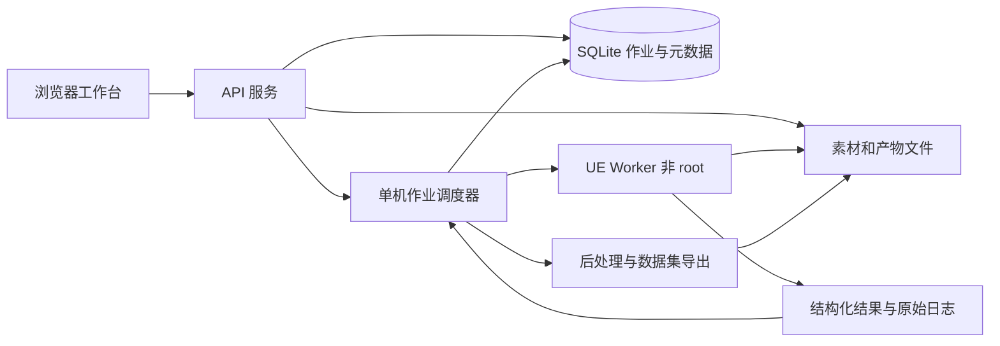

# UE5 感知仿真平台 PRD 与技术方案（工作草案）

版本：0.1｜日期：2026-11-17｜状态：待业务确认；当前事实与目标设计分开标注

## 1. 产品目标

让数据工程师在内网操作台配置道路交通场景、检查真实单帧、提交批量渲染、检查标注，并导出可追溯的训练数据。首个业务对象为交通标志、车道线、车辆、行人和障碍物；首先完成一个能验证的道路场景，再扩充素材与工况。

目标使用流程：准备素材 → 选择场景和相机 → 预览 RGB 与标注 → 配置数量和随机范围 → 小批验收 → 提交批量任务 → 质量检查 → 导出数据集。操作台每一步必须展示真实状态、当前作业和失败原因；未完成的能力不可显示为成功。

## 2. 当前事实（2026-11-17）

- 部署：Windows 工作区和 Ubuntu `10.2.248.34`；操作台端口 8010，UE 5.3 源码引擎及工程位于服务器。生产服务现以 root 启动，UE 作业降权为 algo；需要收敛权限与资源调度。
- 已有：任务清单生成、后处理、COCO/YOLO、VOC、难例与抽检脚本；本地模拟链路自检 23 项通过。该结果不能证明 UE 输出正确。
- UE：独立验证关卡和两个材质文件存在；场景是基础几何代理物，非正式道路、路标或人车资产。深度/语义材质未接入捕获，像素尚未验收；遮挡目前为框近似。
- 预览：已实现异步作业和 PNG 返回；此前实测图像近黑，本次光照调整仍在验证。UE Python 错误可能不反映在进程退出码中，必须以结构化结果及文件检查为准。
- 前端：单 HTML、内联样式与脚本，无 CDN；状态、素材上传、作业、配置等已接入。单帧之外的场景参数下发和按 UI 参数批量生成仍未完成；图片上传只是纹理素材，不是 3D 模型。
- 数据：`/data/queue/tasks.jsonl` 当前 360 条、已完成 0；状态、部分配置、作业记录、文件路径分别存在 JSON/JSONL、内存、日志与文件系统。当前没有业务数据库；重启面板会丢失内存作业列表。
- 风险：真实生产链未验收；UE 工程、部署脚本、文档之间存在路径、接口和行为差异。不可把文件存在或退出码为 0 等同于图片和标注正确。

## 3. 用户与范围

| 用户 | 核心任务 | 成功结果 |
|---|---|---|
| 数据工程师 | 配置并提交任务、查看进度 | 能找到每帧结果与失败原因，重启后状态不丢 |
| 算法工程师 | 检查真值、筛选难例、导出 | 数据集有版本、标注口径与可复现参数 |
| 场景制作人员 | 导入素材、组织场景 | 能追踪素材来源、许可证、单位、类别和版本 |
| 运维 | 管理计算资源与作业 | 能查看资源、队列、日志和服务健康状态 |

MVP 覆盖一个验证场景、单帧 RGB、真实 2D 框、队列、批量 RGB、抽检与 COCO。深度、语义和实例遮挡先以验证门禁推进；正式 GOST 资产、场景编辑器、天气仿真和多机集群列后续版本。真实语义与深度未通过前，界面标为未验收，禁止作为已验证数据集导出。

## 4. 功能需求与验收

| 功能 | MVP 行为 | 验收 |
|---|---|---|
| 状态 | 显示连接状态、采样时间、GPU 已用、温度、内存及磁盘，标注单位和未知值 | 数据与服务器采样一致；断线显示未连接并保留带时间的旧值 |
| 场景 | 列出可用关卡、资产版本和验证状态 | 选择关卡后实际加载该关卡；不存在时明确报错 |
| 素材 | 图片上传、列表、导入 UE；记录来源与许可 | 上传、导入和场景中使用分别有状态；不覆盖同名素材 |
| 预览 | 配置场景、相机与分辨率，异步生成单帧 | 从按钮到图像可追溯到 job、场景和参数；非空、非黑、可见目标；失败显示真实错误 |
| 标注 | 显示类别及 BBox，可切换叠加 | 与 RGB 相同帧、相同分辨率；抽检框位置及裁切正确 |
| 队列 | 参数生成不可变任务快照，启动、停止、重试 | 有唯一 ID、进度及逐帧状态，重启后可恢复 |
| 数据集 | 显示帧数、类别、难例口径，导出 COCO | 图片及标注数量、路径、尺寸与数据集清单一致 |
| 日志 | 显示最近错误、完整日志与作业结果 | 保留原始 UE 日志，错误摘要不掩盖失败；Python 错误不能显示成功 |

阈值和颜色：显存占用、温度与磁盘按配置阈值提示；引擎“已安装”和“渲染进程运行中”分别显示。资源曲线仅展示真实采样，无数据时标注不可用。

## 5. 技术架构（目标）

前端继续单文件、离线可用；后端在现有标准库服务基础上拆分接口、作业调度、存储和 UE 执行模块。先采用单机单 GPU、一次一个 UE 进程；渲染、预览和生成资产共享 GPU 锁。服务器启动不自动触发危险作业；后台收尾动作必须可见并可配置。UE 在非 root 账户运行，服务以专用低权限账户运行；资源目录显式授权，不递归修改引擎与工程所有权。

作业流程：API 校验 → 写入数据库和不可变参数快照 → 资源锁 → 启动 worker → UE 写入临时目录和结构化 result.json → 检查返回状态、文件签名和元数据 → 原子发布产物 → 更新作业状态。脚本异常、超时、进程退出、重启和取消都有明确状态；退出码只是其中一个证据。禁止旧预览冒充新作业结果。

文件目录建议：`/data/ue5_synth/assets/<asset_id>/<version>/`、`runs/<run_id>/frames/<frame_id>/`、`datasets/<dataset_id>/<version>/`、`logs/<job_id>/`；使用临时目录写入后原子重命名。数据库存相对路径、尺寸、校验和及格式，实际图像存文件系统，不把图片放入数据库。

## 6. 数据库设计（建议，尚未实现）

单机 MVP 使用 SQLite（WAL、事务、外键、定期备份）；多机并发和多人协作出现后迁移 PostgreSQL。时间统一 UTC，展示时转换本地时区。JSON 字段保存版本化参数快照，不把易查询的状态和关系藏在 JSON 中。

| 表 | 关键字段 | 用途 |
|---|---|---|
| assets | id、type、name、source、license、status、created_at | 素材身份与许可 |
| asset_versions | id、asset_id、version、path、sha256、metadata_json | 文件和 UE 资产版本 |
| scenes | id、name、ue_map_path、version、validation_status | 场景及验收状态 |
| scene_assets | scene_id、asset_version_id、transform_json、class_id | 场景内素材与位姿 |
| presets | id、type、name、version、params_json | 相机、光照、天气参数模板 |
| jobs | id、type、status、progress、created_at、started_at、finished_at、error、log_path | 可恢复作业状态 |
| runs | id、job_id、scene_id、seed、params_json、engine_version、code_version | 一次可复现运行 |
| frames | id、run_id、frame_index、status、width、height、truth_path、error | 每帧结果与失败信息 |
| artifacts | id、frame_id、kind、format、path、sha256、validation_status | RGB、深度、语义、真值与预览文件 |
| annotations | id、frame_id、class_id、instance_id、bbox_json、occlusion、method | 标注及遮挡计算方法 |
| datasets | id、name、version、status、manifest_path、created_at | 导出版本 |
| dataset_frames | dataset_id、frame_id、split | 数据集帧和训练/验证切分 |
| resource_samples | timestamp、gpu_mem_mb、gpu_util、temperature、mem_used_mb、disk_free_gb | 真实资源采样，可按保留策略清理 |

约束：`frames(run_id, frame_index)`、`dataset_frames(dataset_id, frame_id)` 唯一；只允许作业状态按 queued → running → succeeded/failed/cancelled 转移，重启后 running 进入 interrupted，人工重试产生新 attempt。预览产物必须与 job_id 关联；数据库与文件不一致时标为失效并提供重新扫描。

## 7. 接口契约（目标）

`GET /api/status` 获取带采样时间的系统状态；`GET /api/scenes` 获取场景与验收状态；`GET/POST /api/assets` 管理素材；`POST /api/previews` 提交 `{scene_id, camera, resolution, seed}` 返回 job_id；`GET /api/jobs/{id}` 获取状态与结果；`GET /api/jobs/{id}/logs?offset=` 增量读取；`POST /api/jobs/{id}/cancel` 取消；`POST /api/runs` 创建批次；`GET /api/runs/{id}/frames` 查看帧；`POST /api/datasets` 导出；`GET /api/metrics` 返回真实采样。所有错误统一 `{code,message,details,request_id}`，写操作提供幂等键；图片通过 artifact ID 获取，不接收任意文件路径。

现有 `/api/status`、`/api/run`、`/api/job`、`/api/log`、`/api/config` 等继续兼容，逐项迁移并测试；当前 `/api/preview` 只支持固定验证场景，不应宣传为完整参数预览。

## 8. 图像与标注契约

RGB 原图按实际编码保存 EXR 或 PNG，扩展名、文件头和 manifest 必须一致；训练成品为 PNG。记录色彩空间、位深、曝光和分辨率。深度单位定义为米，明确是相机轴向深度还是径向距离；验证 10 m / 100 m 参照物，不能假定 SceneDepth 即某种编码。语义按类别 stencil；实例掩码使用单独通道或分次捕获，背景为 0。语义图需验证颜色变换、抗锯齿和整数值，避免插值改变标签。真值必须标记遮挡算法（当前 bbox 近似，不能当像素级真值）。

## 9. 阶段与门禁

1. **P0 稳定预览**：修正黑图、照明、相机和异步捕获；建立真实作业失败判定。验收：连续三次生成非黑 RGB，可见已知目标，刷新页面能定位同一结果；保留截图、参数、日志。
2. **P1 最小数据闭环**：固定场景、RGB 与真实框，生成 3–5 帧并完成后处理、COCO 导出与人工抽检。验收：帧图和标注一一对应，重跑与中断恢复正确。
3. **P2 可靠操作台与 SQLite**：持久化 job/run/frame、资源锁、日志、取消与失败重试；现有清单迁移，验证断电恢复。
4. **P3 深度与语义**：专用通道、数值标定、像素级验证与可追溯报告；通过前不标记为可生产。
5. **P4 正式资产与参数化**：素材许可、GOST 标牌、车道线、人车、天气和真实参数下发；用实拍对比标定。
6. **P5 批量与数据集**：小批 20 帧通过后再扩大；统计、质量门禁、版本化导出、性能与磁盘容量实测。

每个阶段的证据包括实际文件、参数、日志、代码版本与验收记录。未通过上一阶段，不将下阶段功能标为可生产。当前不应直接启动 360 帧正式批量。

## 10. 待业务确认

- 实际目标：首批标牌类别、场景、分辨率、样本量、交付格式及时间。
- 夜间是否一律归入光照难例；每帧最大实例数及像素遮挡精度要求。
- 传统材质近似逆反射是否满足业务，是否必须 Substrate；需有实拍对比判据。
- 素材来源、许可和真实资产制作责任；Fab 等外网资源需离线导入内网。
- 安全边界、使用人数、账户权限与数据保留期限。

## 11. 本周建议执行顺序

先修复预览并记录实际效果；核对关卡中目标真实位置与光照；再完成 3–5 帧 RGB + 标注闭环。暂停扩张界面与新增接口，优先解决真实结果、日志可信和任务状态持久化。每项完成后更新本文件的状态与证据链接。
