# PerceptionSim 感知仿真平台 · 问题清单

> 生成时间：2026-11-21 21:45
> 用途：交接给 PPT 独立排查，不依赖之前的对话上下文

---

## 一、平台基础信息

| 项 | 值 |
|---|---|
| 访问地址 | `http://10.2.248.34:8010/` |
| 代码根目录 | `/opt/ue5_synth/` |
| 前端 | `/opt/ue5_synth/dashboard/index.html`（526KB，单文件 SPA） |
| 后端 | `/opt/ue5_synth/dashboard/server.py`（182KB，Python HTTPServer） |
| 工具脚本 | `/opt/ue5_synth/tools/*.py`（110 个） |
| 重启命令 | `pkill -9 -f "server.py 8010"; cd /opt/ue5_synth/dashboard && setsid nohup python3 server.py 8010 > panel.log 2>&1 < /dev/null &` |
| GPU | RTX 4070 Ti 12GB |
| Python | `/opt/ad_mining/venv/bin/python`（torch 2.4.1，cv2 5.0） |

---

## 二、三个模块说明

| 模块 | 功能 | 数据 |
|---|---|---|
| **TSR** | 交通标志替换（2D 贴图） | 素材库 33716 个 |
| **OBJ** | 3D 障碍物仿真（插入合成车辆） | `/data/render/obj_good` 460 帧 / 12 批次 |
| **GND** | 地面车道线重绘 | `/data/render/gnd_fusion` 1200 帧 / 60 批次 |

---

## 三、用户报告的 6 个核心问题

> 所有截图在 `问题清单附图_20261121/` 目录

### 问题 1：切任务没反应（最严重）

**现象**
点顶部 TSR / OBJ / GND 三个按钮，界面不切换。

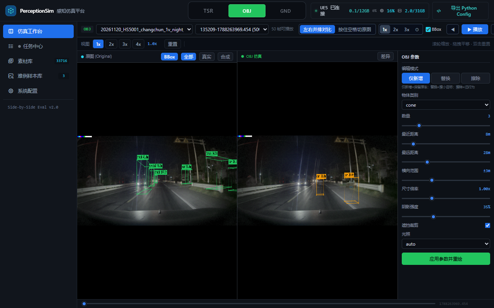

**已做的修复**
- `index.html` 中 `setModule()` 函数，原来在 `try/catch` 后无条件 `return`，导致即使 `__openClipPlayer()` 抛异常界面也卡在原模块。已改为失败也强制切视图。
- 暴露了 `window.__ensureClipView`。

**当前状态**
- 我用 Playwright 自动化测试：三个按钮切换**全部正常**
- 用户实际操作时报告仍不行，但**未提供浏览器控制台的报错信息**

**排查建议**
1. 打开浏览器 F12 → Console，点 OBJ，看有没有红色报错
2. 检查 `window.__MODFILTER` 的值
3. 检查 `.task-pill[data-task="obj"]` 的点击是否真的触发

**相关代码位置**
- `index.html` 约 9360 行：`setModule()` 函数
- `index.html` 约 9385 行：`document.addEventListener('click', ...)` 拦截胶囊点击

---

### 问题 2：OBJ 打开后仿真图不变化 / 黑屏

**现象**
右栏仿真图要么黑屏，要么每帧都一样。

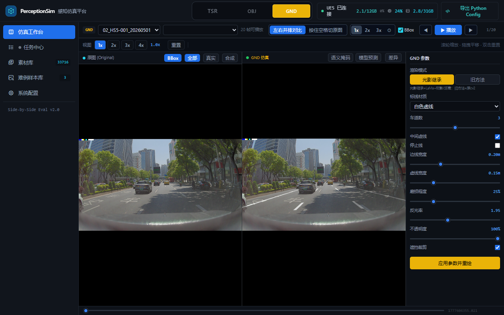

**根因（已定位）**
1. `/api/real/batch`、`/api/real/image`、`/api/real/clip_play` 三个接口**只在 `/data/test_data/real_clips` 查找**，不认 `/data/test_data/real_clips_extra`（大部分数据在这里）
2. 用户打开的 clip 在 `obj_good` 里**没有仿真产出**，后端回退成原图

**已做的修复**
- 三个接口都加了双目录查找
- `/api/real/clips` 只返回有 `obj_good` 产出的批次（12 个）
- `/api/real/batch` 只返回有产出的 clip
- `clip_play` 只返回有产出的帧

**当前状态**
- 我用正确的批次 + clip 测试：**正常显示，50 帧，9 个 3D 物体**
- 但用户打开 `20261120_MG6002_changchun_1v_podao` 时，批次下拉显示 podao，clip 却是 `135209-1788264674.456`（属于 night_specialcar）—— **批次和 clip 未严格配对**

**排查建议**
1. 检查 `loadClips()` 在批次切换时是否真的清空了旧 clip
2. 检查 `cpBatch` 和 `cpClip` 两个下拉的联动

**相关代码位置**
- `server.py` 约 1315 行：`/api/real/batch`
- `server.py` 约 1460 行：`/api/real/clip_play`
- `index.html` 约 11941 行：`loadClips()`

---

### 问题 3：OBJ 合成的车是"破的"

**现象**
右栏合成的车出现灰色块、透明洞、车身破碎。

**问题现场**
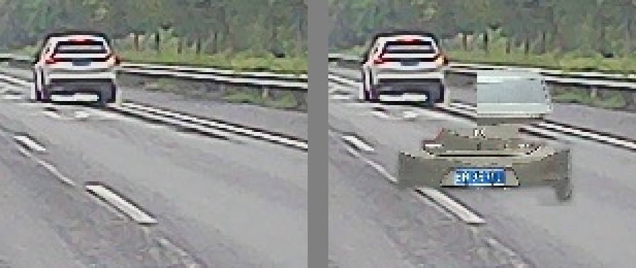

**修复后**
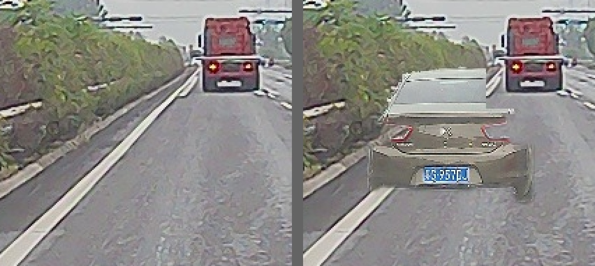

**根因（已定位并修复）**
1. `project_quad()` 计算投影四边形时用 `w_m/h_m`（物理尺寸），但 sprite 宽高比不匹配，导致拉伸
2. sprite 素材 `20261120_HS5001__1788053802.3_0.png` 本身完好（456×344，完整黑色轿车）

**已做的修复**
- `project_quad()` 改用 `h_m * px_per_m` 计算高度
- `composite_multiply()` 去掉过激的连通域裁剪

**当前状态**
- 单独渲染测试：**车完整显示**（见 `/tmp/shadow_ab.jpg`）
- 前端是否需要重新批量渲染尚未验证

**相关代码位置**
- `tools/pipeline_sim.py` 约 255 行：`project_quad()`
- `tools/render_core.py` 约 230 行：`composite_multiply()`

---

### 问题 4：GND 车道线"没变化"

**现象**
GND 仿真图和原图看起来一样。

**GND 光影继承效果（左原图 中擦除 右重绘+差异）**
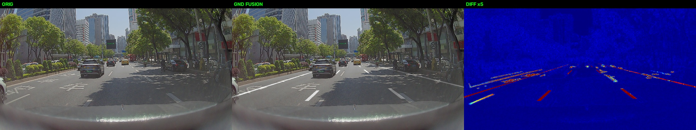

**根因**
- GND 默认参数是"还原原车道线"，所以差异只有 0.6%-1.6%
- 用户期望更明显的视觉差异

**已做的修复**
- 接入 LaMa 擦除 + LAB 光影继承（`tools/gnd_fusion.py`）
- 前端加了"差异"按钮，显示改动位置和占比

**排查建议**
- 是否需要在 UI 上默认显示差异高亮
- 或者调整默认参数让效果更明显

**相关代码位置**
- `tools/gnd_fusion.py`：LaMa + 光影继承
- `tools/pipeline_sim.py` 的 GND 分支

---

### 问题 5：网盘数据风险

**现状**
- `/mnt/` 下的网盘是 `rw`（读写）挂载，**系统层面没有只读保护**
- 只靠代码约束：`tools/data_guard.py` 拦截所有 `/mnt/` 写入
- 验证结果：拦截生效，且 `/mnt/` 下最近 24h 的改动只有别人的 `.Trash` 目录

**风险**
如果有人绕过 `data_guard` 直接 `os.remove('/mnt/...')`，无法阻止。

**建议**
- 把 `/mnt/` 改为只读挂载（`mount -o remount,ro`）
- 或在 `data_guard.py` 之外再加一层文件系统权限

---

### 问题 6：数据质量问题

**OBJ 场景选择**
- 最初用的 `extremely_closetruck`（正前方大卡车）不适合：卡车占大半画面，没有空位放置新物体
- 已删除 3.3GB 低质量数据，改为 14 个"优质场景"

**优质场景筛选标准**
```python
空位 > 40%  且  无大框（>5% 画面）  且  最近车 > 12m
```
结果：14 个场景，每帧 1-3 个合成物体

**优质场景效果（左原图 右仿真）**
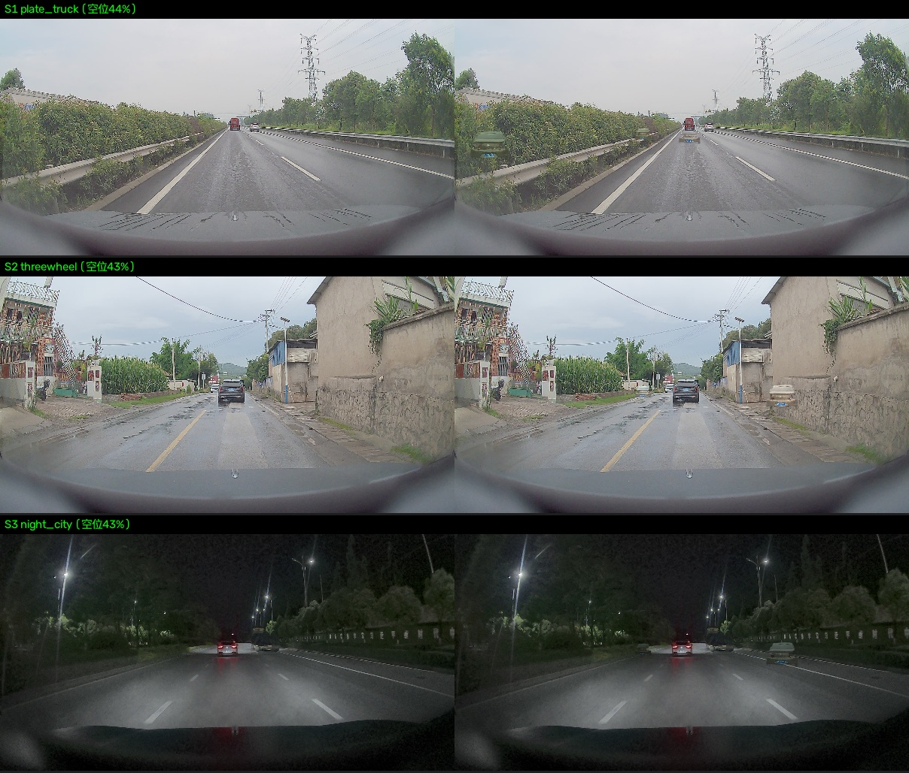

**OBJ 车辆合成细节对比**
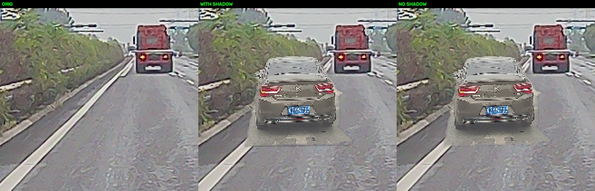

**Sprite 素材原图（证明素材本身完好）**
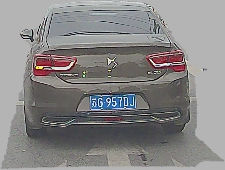

---

## 四、当前数据统计

| 项 | 数量 |
|---|---|
| OBJ 仿真帧 | 460 |
| OBJ 批次 | 12 |
| GND 仿真帧 | 1200 |
| GND 批次 | 60 |
| 3D 标注文件 | 460（OBJ） |
| ignore 掩码 | 460 |

**OBJ 批次列表（12 个，都有产出）**
```
20261120_HS5001_changchun_1v_night_specialcar      3 clip
20261106_HS5001_guizhou_1v_night_wuludeng_highway  2 clip
20261106_HS5001_guizhou_1v_plate_truck             1 clip
20261111_HS5001_qianmo_1v_threewheel               2 clip
20261117_HS5001_guizhou_1v_night_city_truck        2 clip
20261119_HS5001_qianmo_1v_closecar                 2 clip
20261120_HS5001_changchun_1v_overlap               2 clip
20261120_MG6002_changchun_1v_ground_text           1 clip
20261120_MG6002_changchun_1v_night_cloak_van       1 clip
20261120_MG6002_changchun_1v_night_highway_truck   1 clip
20261120_MG6002_changchun_1v_podao                 1 clip
20261120_MG6002_changchun_1v_rain                  2 clip
```

---

## 五、代码架构问题（根本原因）

### 5.1 前端是 526KB 单文件

```
index.html: 526,372 字节
├── HTML 结构
├── CSS 内联
├── 20+ 个 IIFE 模块（VIEWER-ZOOM / MODULE-PARAMS / CLIP-PLAYER / ...）
└── 全部在一个 <script> 块里（461KB）
```

**问题**
- 任何一处语法错误会导致整个 script 块不执行
- 修改风险极高（我已经多次改坏又回滚）
- 无法用 esprima/pyjsparser 解析（用了 `?.` 和模板字符串）

**建议**
- 拆成多个 JS 模块
- 或至少用 webpack/vite 打包

### 5.2 后端路由散落在两个函数

`server.py` 的 `do_GET` 和 `do_POST` 各 1500+ 行，路由注册在一个巨大的 `if/elif` 链里。

**建议**
- 用路由表或 Flask/FastAPI 重构

### 5.3 数据目录混乱

```
/data/render/
├── obj_good/       ← 当前用
├── gnd_fusion/     ← 当前用
├── final_obj/      ← 已删
├── final_obj2/     ← 已删
├── final_obj3/     ← 已删
├── gnd_model/      ← 旧版（可能还在用）
├── pipe_*/         ← 历史遗留
└── tsr_*/          ← 历史遗留（60+ 个目录）
```

---

## 六、给 PPT 的具体任务

### 优先级 P0（阻塞用户）

1. **彻底修好切任务**
   - 复现：打开 `http://10.2.248.34:8010/`，点 OBJ，看是否切换
   - 如果用户环境不行而自动化测试通过，需要抓浏览器实际报错
   - 建议：在 `setModule()` 里加 `console.error` 到 UI 上的错误提示，让用户直接看到

2. **彻底修好 OBJ 显示**
   - 验证批次和 clip 的联动
   - 确认打开任意批次都能看到仿真图

### 优先级 P1（质量问题）

3. **OBJ 合成车辆质量**
   - 重新批量渲染（用修复后的 `render_core.py`）
   - 检查车辆比例、位置、阴影

4. **GND 效果可见性**
   - 默认开启差异高亮
   - 或调整默认参数

### 优先级 P2（架构）

5. **前端拆分**
   - 把 526KB 单文件拆成模块

6. **数据目录整理**
   - 删除 60+ 个历史遗留目录

7. **网盘只读保护**
   - `mount -o remount,ro /mnt/done_data_new` 等

---

## 七、关键文件清单

| 文件 | 作用 |
|---|---|
| `/opt/ue5_synth/dashboard/index.html` | 前端 SPA（526KB） |
| `/opt/ue5_synth/dashboard/server.py` | 后端 API（182KB） |
| `/opt/ue5_synth/tools/pipeline_sim.py` | OBJ/GND 渲染主流程 |
| `/opt/ue5_synth/tools/render_core.py` | 合成核心（阴影/线性空间/保护区） |
| `/opt/ue5_synth/tools/gnd_fusion.py` | GND LaMa + 光影继承 |
| `/opt/ue5_synth/tools/annot_train.py` | 训练标注增强 |
| `/opt/ue5_synth/tools/build_obj_from_lidar.py` | sprite 素材生成 |
| `/opt/ue5_synth/tools/data_guard.py` | 网盘写入保护 |

---

## 七之补充、界面现状截图

**前端模式选择器（OBJ 三模式 / GND 两模式）**


**工具栏布局（对齐 TSR）**


**GND 语义掩码显示**
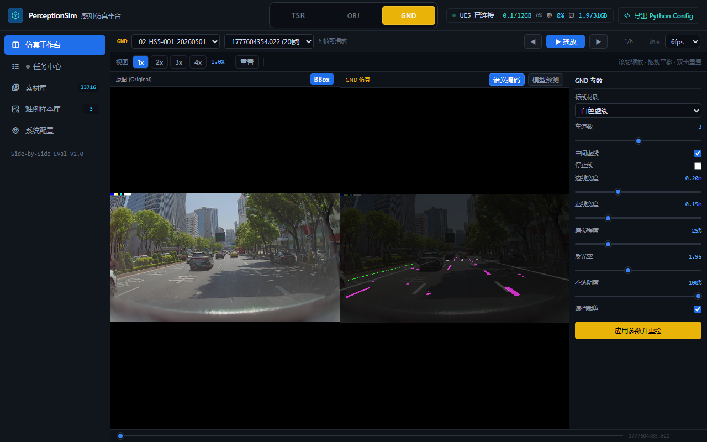

**全屏双栏 BBox 对比**
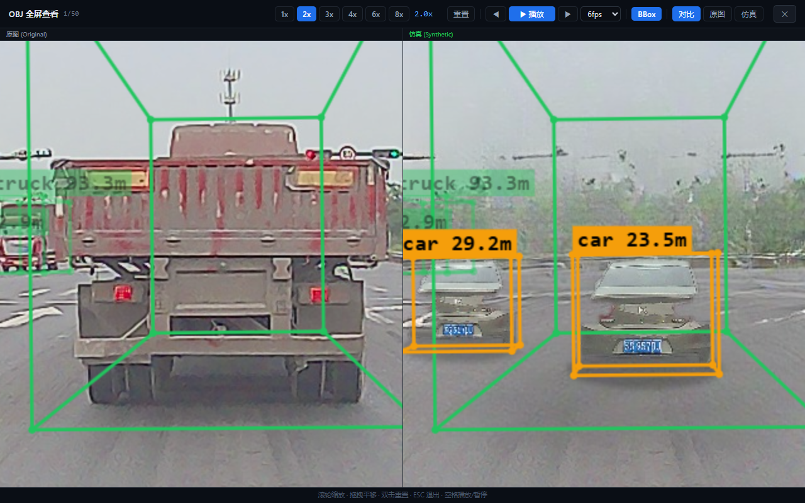

**OBJ 多场景批量验证**


**Sprite 新旧算法对比（新算法反而更差，已回滚）**
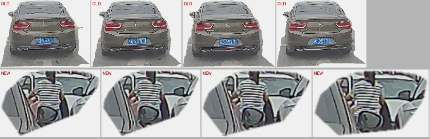

---

## 八、可复现的测试命令

```bash
# 1. 检查服务
curl -s -o /dev/null -w "%{http_code}\n" http://127.0.0.1:8010/

# 2. 检查数据
ls /data/render/obj_good/frames/*_sim.jpg | wc -l
ls /data/render/gnd_fusion/frames/*_sim.jpg | wc -l

# 3. 检查批次
curl -s "http://127.0.0.1:8010/api/real/clips" | python3 -m json.tool

# 4. 检查 clip_play
curl -s "http://127.0.0.1:8010/api/real/clip_play?batch=20261120_HS5001_changchun_1v_night_specialcar&clip=135209-1788263969.454&module=obj" | python3 -m json.tool | head -30

# 5. 单帧渲染测试
cd /opt/ue5_synth/tools
/opt/ad_mining/venv/bin/python pipeline_sim.py \
  --batch 20261106_HS5001_guizhou_1v_plate_truck \
  --clip 133000-1788049041.923 --module obj --frames 2 --out /tmp/test \
  --config '{"edit_mode":"add","count":3,"cls":"car","dist_min":15,"dist_max":45}'
```

---

## 九、我的判断

**问题 1（切任务）和问题 2（OBJ 显示）都是可以定位的技术问题，但我缺少你浏览器里的实际报错。**

**建议 PPT 的第一步：让用户打开 F12，把所有红色报错截图发出来。** 有了报错信息，这两个问题能在 10 分钟内定位。

如果自动化测试通过但用户实际操作不行，最可能是：
- 浏览器缓存了旧版本（服务端已设 `no-store`，但可能被代理缓存）
- 用户访问的不是同一个地址
- 某个浏览器扩展干扰

---

**文档结束**
